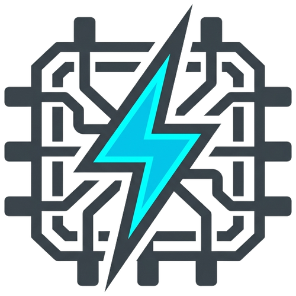
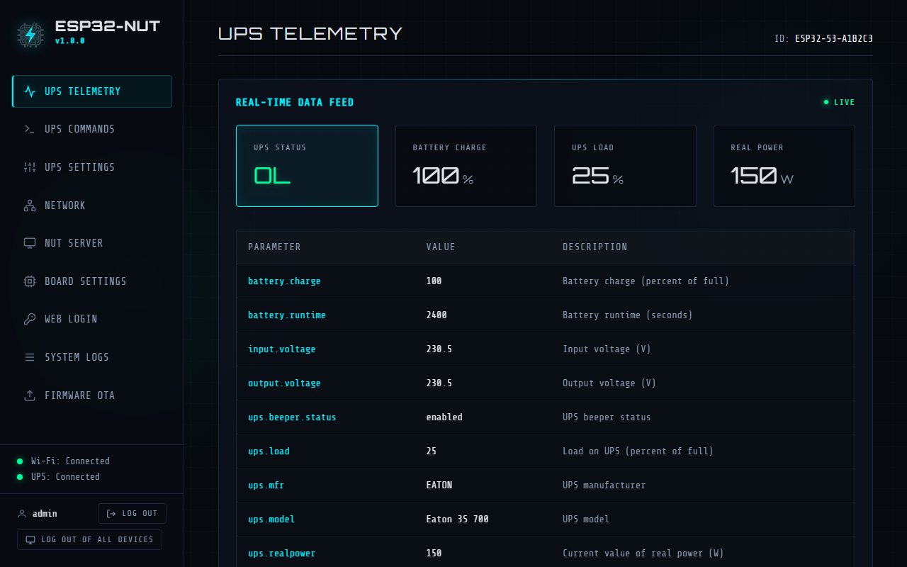
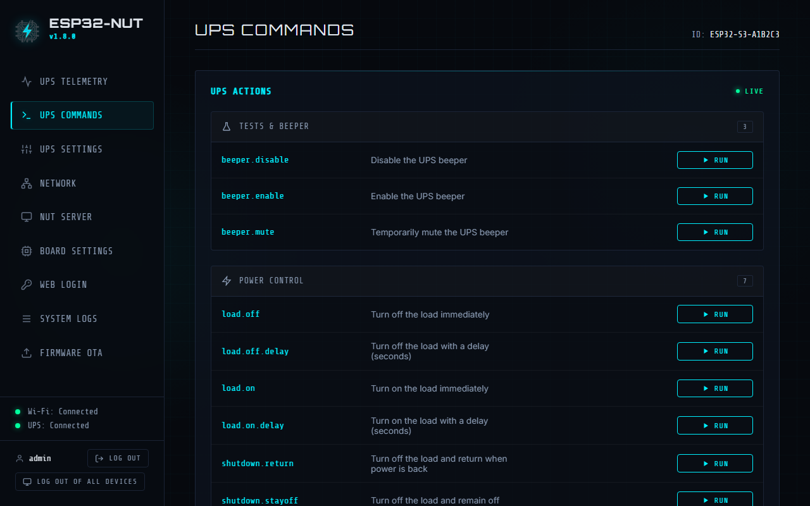
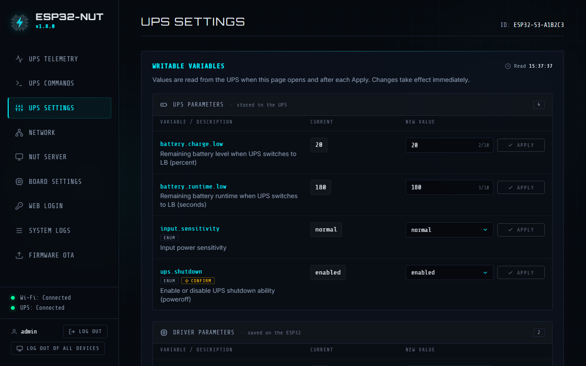
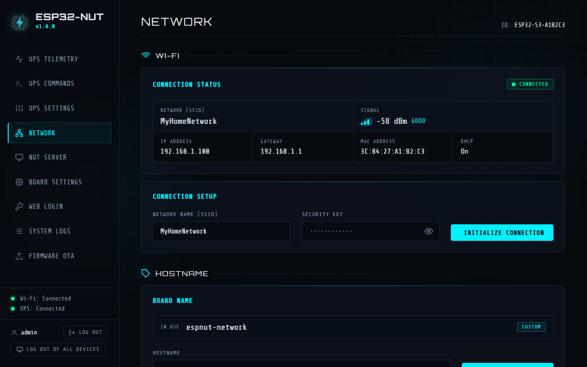
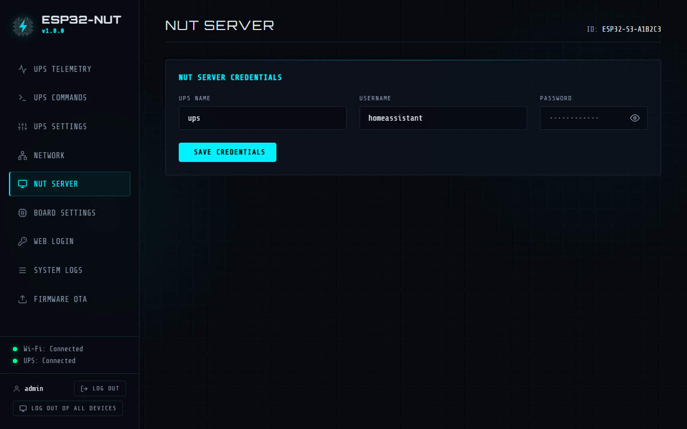
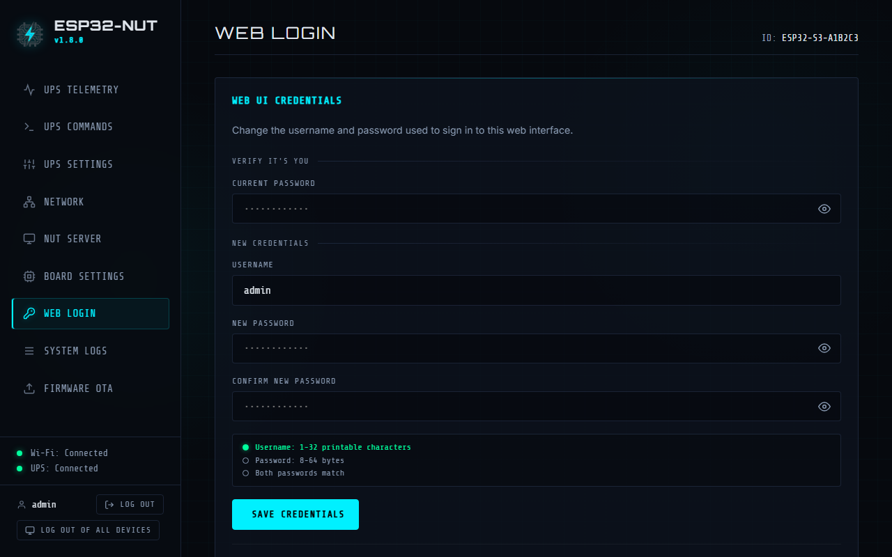
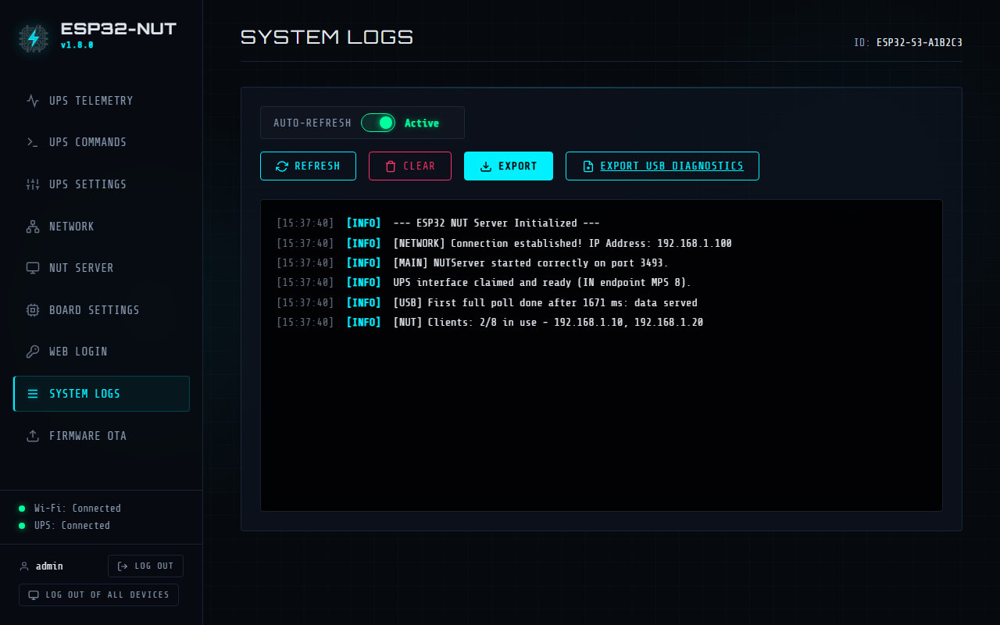
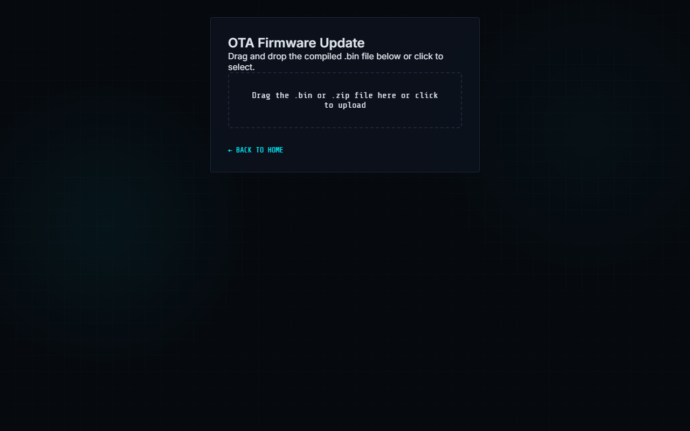
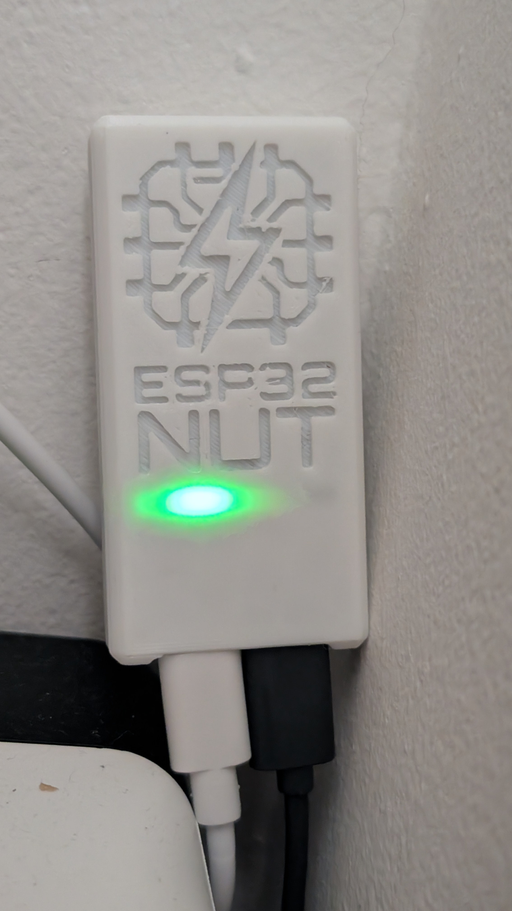

#  ESP32 NUT Server Bridge

*🇬🇧 [Read in English](README.md)*

> [!WARNING]
> **Aggiorni da una versione v1.5.x o precedente? Installa la v1.6.x o successive con il [web installer](https://maverick1982.github.io/esp32-nut/), non con un aggiornamento OTA.**
>
> La v1.6 aggiunge una nuova partizione della flash (`coredump`) che conserva i dettagli dei crash per la diagnostica. Un aggiornamento OTA non può modificare la tabella delle partizioni: la scheda funzionerebbe, ma senza quella partizione.
>
> Quando l'installer chiede **"Do you want to erase the device before installing?"**, lascia **"Erase device" deselezionato** e premi **Next**: le impostazioni Wi-Fi e NUT vengono conservate. Selezionalo solo se vuoi un'installazione pulita (la scheda ripartirà in modalità configurazione con l'access point `NUT_ESP32_Config`).
>
> Dopo questa installazione, una tantum, gli aggiornamenti successivi si possono di nuovo fare via OTA.

Un firmware open-source per schede ESP32-S3 (Wi-Fi, oppure Ethernet con un modulo W5500) ed ESP32-P4 (Ethernet) che funge da **Server NUT (Network UPS Tools) bridge** standalone. Si connette a un gruppo di continuità (UPS) USB (Eaton, APC, CyberPower, Powercom e altri) tramite USB Host e ne espone i dati sulla rete locale utilizzando il protocollo standard NUT (porta 3493) e un'interfaccia web integrata.

Questo progetto permette di integrare facilmente il tuo UPS (che magari dispone solo della porta USB) in sistemi come Home Assistant, TrueNAS, Synology o qualsiasi altro client NUT senza la necessità di tenere acceso un Raspberry Pi o un PC 24 ore su 24.

## 🌟 Funzionalità

- **Supporto USB Host Nativo**: Legge direttamente i dati HID dai dispositivi UPS compatibili via USB (testato con Eaton, APC, CyberPower, Powercom).
- **Protocollo Server NUT**: Implementa il protocollo standard NUT, rendendolo immediatamente compatibile con i client NUT esistenti (`upsc`, `upsmon`, Home Assistant, PeaNUT, …), fino a 8 contemporaneamente.
- **Comandi UPS**: Test della batteria e del pannello, beeper, comandi di carico e di spegnimento, dalla Web UI oppure con `upscmd` e Home Assistant, come con il driver `usbhid-ups` di NUT.
- **Parametri UPS**: Modifica dei parametri che l'UPS permette di cambiare (soglie di batteria scarica, punti di intervento, data della batteria, ritardi di spegnimento, …) dalla Web UI oppure con `upsrw`.
- **Variabili NUT personalizzate**: Nella scheda **NUT Server** puoi aggiungere variabili che l'UPS non fornisce (es. `battery.date`) o sostituire un valore sbagliato (es. `ups.model`), come `override.*` in `ups.conf`. Le vedono solo i client NUT; la dashboard continua a mostrare i valori reali dell'UPS.
- **Spegnimento automatico**: In **Board Settings** la scheda può inviare da sola `shutdown.default` all'UPS a batteria scarica, anche senza client NUT collegati (per gli UPS che alimentano una TV, un impianto audio o altri dispositivi senza `upsmon`).
- **Interfaccia Web & Captive Portal**: Una dashboard web moderna e responsiva protetta da login, con la configurazione del Wi-Fi tramite captive portal sull'ESP32-S3.
- **Pagina Network e nome host**: Lo stato di ogni collegamento della scheda (Wi-Fi o Ethernet) e il nome host che la scheda comunica al router.
- **Log remoto e ora di rete**: Invio del System Log a un server syslog (UDP, RFC 3164 o RFC 5424), con l'ora da un server NTP e il fuso orario che preferisci.
- **Diagnostica USB**: Un clic nella scheda **System Logs** esporta un file con tutto ciò che l'UPS riporta, da allegare a una segnalazione di bug o di compatibilità.
- **Aggiornamenti Over-The-Air (OTA)**: Carica nuove versioni del firmware direttamente dal browser web senza collegare fisicamente la scheda al PC.
- **LED di stato (ESP32-S3)**: Feedback visivo immediato sullo stato della rete e del collegamento con l'UPS, con luminosità regolabile.
- **ESP32-P4 con Ethernet**: Rete via cavo, e PoE sulle schede che lo prevedono, con schede ESP32-P4 come la Waveshare ESP32-P4-ETH (vedi [ESP32-P4 (Ethernet)](#esp32-p4-ethernet)).
- **Ethernet W5500 sull'ESP32-S3**: Rete via cavo, e PoE sulle schede che lo prevedono, con un modulo SPI W5500 o una scheda che lo integra. In modalità Automatic la scheda passa da sola tra cavo e Wi-Fi (vedi [Ethernet con un modulo W5500](#ethernet-con-un-modulo-w5500-esp32-s3)).

## 🔌 UPS Supportati

Il firmware utilizza le mappature HID ufficiali del progetto Network UPS Tools (NUT) e supporta automaticamente diversi produttori:

<b>Eaton</b> (Clicca per espandere i modelli testati)

- Serie Eaton 3S
- Eaton 5P 1U
- Eaton Ellipse PRO 650, Ellipse ECO 650
- MGE Protection Center

<b>APC</b> (Clicca per espandere i modelli testati)

- APC Back-UPS CS 500
- APC BackUPS Pro 900
- APC Back-UPS Pro BN1050M, BGM2200
- APC Back-UPS XS 700U, XS 1500M
- APC Back-UPS BX750MI, BX1200MI, BXR1200MI
- APC Back-UPS ES 600M1, ES 700G
- APC Smart-UPS 750, 750L, 1000L

**Serie Back-UPS BX:** il firmware APC di questi modelli smette di rispondere alle richieste USB a intervalli irregolari, spesso più volte all'ora (succede anche con NUT su Linux). La scheda si riprende da sola pochi secondi dopo ogni blocco, e lo stato dell'UPS continua ad aggiornarsi fino a quel momento. I client NUT possono comunque vedere i dati non aggiornati per qualche secondo. ([#60](https://github.com/maverick1982/esp32-nut/issues/60))

**Smart-UPS:** a volte una richiesta USB resta bloccata. Dalla v1.14.0 la scheda spegne e riaccende la sua porta USB invece di riavviarsi: l'UPS torna in pochi secondi mentre rete, Web UI e server NUT restano attivi. ([#78](https://github.com/maverick1982/esp32-nut/issues/78), [#120](https://github.com/maverick1982/esp32-nut/issues/120))

<b>CyberPower</b> (Clicca per espandere i modelli testati)

- CyberPower UT650EG, UT850EG
- CyberPower CP 1350C / CP1350AVRLCD
- CyberPower CP1500AVRLCDa
- CyberPower CP1500EPFCLCD, CP1600EPFCLCD
- CyberPower CP2000EIPFCRM2U
- CyberPower CP1500PFCLCDa
- CyberPower CP1500PFCRM2U
- CyberPower SL700U

<b>Powercom</b> (Clicca per espandere i modelli testati)

- Powercom SPD-750U

<b>Legrand</b> (Clicca per espandere i modelli testati)

- Legrand Keor PDU 800

<b>Powerwalker</b> (Clicca per espandere i modelli testati)

- Powerwalker VI 2200 SHL

<b>EcoFlow</b> (Clicca per espandere i modelli non testati / forniti dalla community)

- EcoFlow River 3 Plus
- EcoFlow Delta 3 Plus

**Non testati / forniti dalla community.** Questi modelli sono riconosciuti dal driver ma non sono ancora stati validati su hardware reale.

<b>WalleCube</b> (Clicca per espandere i modelli testati)

- WalleCube Smart UPS W150

 

- **Generici / Altre Marche**: Se la marca dell'UPS non è riconosciuta, il sistema usa un driver generico che legge i valori standard USB HID (carica e autonomia della batteria, carico, tensioni, stato). I valori specifici della marca possono mancare. In questo caso, o per segnalare un problema su un driver esistente, usa il pulsante **Export USB Diagnostics** nella Web UI (tab System Logs) per scaricare un file diagnostico (`usb_diagnostics.json`) e allegalo quando apri una Issue su GitHub.

> [!TIP]
> **Il tuo UPS funziona ma non è nell'elenco?** Segnalacelo con il modulo [UPS Compatibility Report](https://github.com/maverick1982/esp32-nut/issues/new?template=ups_report.yml): lo aggiungeremo ai modelli testati. Allegare il file `usb_diagnostics.json` ci aiuta a verificare le release future sul tuo modello.

> [!NOTE]
> **Requisito Protocollo USB HID:** Questo firmware supporta attualmente solo UPS conformi allo standard **USB HID Power Device Class** (`usbhid-ups`). I gruppi di continuità che comunicano tramite convertitori USB-Seriale o protocolli seriali proprietari (es. Megatec/Q1, serial over USB CDC) non sono attualmente supportati.

## 📸 Screenshot

| Telemetria UPS | Comandi UPS |
| :---: | :---: |
|  |  |

| Parametri UPS | Rete |
| :---: | :---: |
|  |  |

| Server NUT | Login Web |
| :---: | :---: |
|  |  |

| Log di Sistema | Aggiornamento OTA |
| :---: | :---: |
|  |  |

## 🛠 Requisiti Hardware & Cablaggio

- **Scheda ESP32-S3 o ESP32-P4**: È **obbligatorio** utilizzare una scheda di sviluppo ESP32-S3, oppure una scheda ESP32-P4 con Ethernet tra quelle supportate (vedi [ESP32-P4 (Ethernet)](#esp32-p4-ethernet)), perché questi chip supportano l'USB OTG Host in modo nativo. I normali ESP32 o ESP32-C3 non funzioneranno.
- **Modulo Ethernet W5500 (facoltativo, ESP32-S3)**: per la rete via cavo al posto del Wi-Fi, un modulo W5500 esterno o una scheda che lo integra (vedi [Ethernet con un modulo W5500](#ethernet-con-un-modulo-w5500-esp32-s3)).
- **Cavo USB OTG**: Un adattatore per collegare il cavo USB dell'UPS all'ESP32-S3. La Waveshare ESP32-P4-ETH richiede un cavo diverso (vedi [ESP32-P4 (Ethernet)](#esp32-p4-ethernet)).
- **Hub USB e prolunghe attive**: un cavo USB lungo con amplificatore integrato contiene un hub USB. Sulla porta High-Speed dell'ESP32-P4 un hub High-Speed nasconde l'UPS (un dispositivo Full-Speed): lo stack USB host di ESP-IDF non raggiunge un dispositivo Full-Speed dietro un hub High-Speed. Usa un cavo passivo, oppure metti un isolatore USB solo Full-Speed (basato su ADuM3160) tra la scheda e il cavo. Sull'ESP32-S3, la cui porta USB è solo Full-Speed, un cavo del genere dovrebbe funzionare senza isolatore (non provato). ([#113](https://github.com/maverick1982/esp32-nut/issues/113))

### Configurazione su Board generiche con doppia USB-C (es. Generic ESP32-S3 DevKit)
Molte schede generiche ESP32-S3 con due porte USB-C nascondono delle piazzole (solder pads) sul retro per abilitare la modalità Host. Per ottenere un'installazione pulita senza saldare manualmente fili ai pin GPIO:
1. **Saldare le piazzole "USB-OTG"**: Sul retro della scheda, trova le due piazzole denominate `USB-OTG` e uniscile con una goccia di stagno. Questo convoglia i 5V alla porta `USB`, permettendole di agire da Host per alimentare l'interfaccia USB dell'UPS.
2. **Saldare le piazzole "RGB" (Facoltativo)**: Unisci le piazzole `RGB` se desideri abilitare il LED di stato integrato.
3. **Alimentazione**: Collega un alimentatore da muro alla porta etichettata `COM` (o `UART`).
4. **Dati**: Collega un adattatore USB-C OTG alla porta etichettata `USB` e collegalo all'UPS.

### ESP32-P4 (Ethernet)

Al posto dell'ESP32-S3 si può usare una scheda ESP32-P4 con porta Ethernet:
- **Schede supportate**: Waveshare ESP32-P4-ETH (anche la versione PoE), Waveshare ESP32-P4-WIFI6-POE-ETH (provata, [#108](https://github.com/maverick1982/esp32-nut/issues/108); il chip Wi-Fi ESP32-C6 non viene usato, la scheda funziona via Ethernet) e le schede che seguono il design di riferimento Espressif (PHY IP101). Una scheda cablata in modo diverso richiede un suo profilo: apri una issue.
- **UPS**: sulla porta USB 2.0 High-Speed (l'header a 4 pin J3 sulla Waveshare ESP32-P4-ETH). Su questa scheda la porta USB-C non è una porta host: un adattatore OTG collegato lì non vede mai l'UPS. Usa sul J3 un cavo da JST 1,25 mm a 4 pin a presa USB-A, con tutti e quattro i fili: l'UPS ha bisogno della linea a 5V per rilevare l'host, e con solo GND, D- e D+ collegati non compare. ([#140](https://github.com/maverick1982/esp32-nut/discussions/140))
- **Rete**: solo via cavo. L'indirizzo arriva via DHCP e il nome host è `esp32-nut-xxxxxx` (ultimi 3 byte del MAC). Non ci sono Wi-Fi né access point.
- **Due immagini, una per revisione del chip**:

| Immagine | Revisione del chip | Test su hardware |
| :--- | :--- | :--- |
| ESP32-P4 v3.1 or later | v3.1 e successive (produzione attuale) | Provata da [rtadams89](https://github.com/rtadams89) su una scheda v3.2, con un UPS ([#94](https://github.com/maverick1982/esp32-nut/issues/94)) |
| ESP32-P4 before v3 | v1.x (prime schede) | Provata da [rtadams89](https://github.com/rtadams89) su una scheda v1.3, con un UPS |

Per conoscere la revisione, esegui `esptool chip-id` (`esptool.py chip_id` con esptool v4; l'output riporta `Chip is ESP32-P4 (revision v1.3)`) oppure cerca `chip revision: v1.3` nel log di avvio sulla seriale. Le revisioni v2.x e v3.0 non sono supportate da nessuna delle due immagini. Un'immagine per la revisione sbagliata viene rifiutata, dal bootloader in un'installazione completa e dalla scheda in un aggiornamento OTA, quindi basta installare l'altra.

Grazie a [rtadams89](https://github.com/rtadams89) per il supporto ESP32-P4 ed Ethernet.

### Ethernet con un modulo W5500 (ESP32-S3)

Un ESP32-S3 può usare l'Ethernet via cavo con un modulo SPI W5500: un modulo esterno collegato alla DevKit, oppure una scheda con il W5500 integrato. Non esiste uno schema di pin comune tra queste schede, quindi i pin li inserisci sempre tu nella scheda **Network** ([#64](https://github.com/maverick1982/esp32-nut/issues/64)).

- **Fili**: SCK, MOSI, MISO e CS sono obbligatori; INT e RST sono facoltativi. Alimenta il modulo a 3,3 V e collega GND. Senza INT la scheda legge il chip a intervalli regolari; senza RST non viene fatto il reset hardware del modulo.
- **Pin non ammessi** (la pagina li rifiuta): GPIO 19-20 (porta USB dell'UPS), 22-25 (non presenti sull'ESP32-S3), 26-37 (flash e PSRAM), 43-44 (console seriale), i pin del LED di stato (48 e 38 sulla DevKit) e lo stesso GPIO in due campi.
- **Pin di strapping** (GPIO 0, 3, 45, 46): ammessi con un avviso, perché la scheda potrebbe non avviarsi se il modulo ne tiene uno alto o basso all'accensione.
- **Attivazione**: nella scheda **Network**, sezione **Ethernet module (W5500)**, attiva **Use a W5500 module**, inserisci i GPIO e salva. La scheda si riavvia. I valori di esempio in grigio (SCK 12, MOSI 11, MISO 13, CS 10, INT 9, RST 14) sono sei pin adiacenti sul connettore della DevKitC-1, nessuno di strapping.
- **Collegamento da usare** (**Link to use**): con il modulo attivo la sezione W5500 offre tre scelte. È attivo un solo collegamento alla volta e la scheda ha lo stesso nome host su entrambi (quello della scheda **Network**, oppure il predefinito `esp32-nut-xxxxxx`).
  - **Automatic** (predefinito): Ethernet se il cavo ha il link e riceve un indirizzo in DHCP, altrimenti Wi-Fi. Se il cavo viene staccato mentre la scheda è accesa, passa al Wi-Fi entro 30 s e torna all'Ethernet quando il cavo viene ricollegato; ogni passaggio lascia una riga nel **System Log**. Se il cavo ha il link ma il router non gli dà un indirizzo, la scheda resta sul Wi-Fi e riprova il cavo quando viene ricollegato, oppure dopo 5 minuti. Il passaggio richiede una rete Wi-Fi configurata: non va mai verso l'access point né parte da lì.
  - **Ethernet**: solo il cavo. Senza cavo la scheda resta senza rete e lo scrive nel **System Log**; usa il Wi-Fi solo se il W5500 non risponde, così dei pin sbagliati non ti chiudono fuori. Per l'access point usa il doppio reset.
  - **Wi-Fi**: solo il Wi-Fi, il W5500 non viene usato.
- **Stesso indirizzo sui due collegamenti**: su una scheda con Wi-Fi il W5500 usa l'indirizzo MAC del Wi-Fi, quindi il router vede un solo dispositivo e gli dà lo stesso indirizzo via cavo e via Wi-Fi. Una prenotazione DHCP per quel MAC vale per entrambi. La scheda non ha mai un indirizzo su tutti e due insieme: tornando all'Ethernet spegne prima il Wi-Fi e poi chiede l'indirizzo via cavo, quindi resta senza rete per qualche secondo.
- **Dopo un passaggio** il server NUT chiude le sessioni aperte, così i client NUT (Home Assistant, upsmon) si ricollegano subito. Le impostazioni di NUT, syslog e NTP valgono su entrambi i collegamenti.
- **Ritorno al Wi-Fi all'avvio**: in Automatic, se il W5500 non risponde (pin errati, modulo assente), se il cavo non ha il link entro 5 s o se il router non dà un indirizzo entro 15 s, la scheda parte in Wi-Fi, oppure in access point se il Wi-Fi non è configurato. In modalità Ethernet solo un W5500 che non risponde manda la scheda al Wi-Fi. Il **System Log** e la sezione W5500 spiegano il motivo. Il doppio reset avvia sempre l'access point.
- **Primo avvio di una scheda con W5500 integrato**: la scheda parte in access point come sempre. Inserisci i pin e attiva il modulo dall'access point (o dopo aver configurato il Wi-Fi): dopo il riavvio la scheda entra in rete via cavo.

**Pin noti.** Verificali sullo schema della tua scheda; per aggiungere una scheda manda una PR.

| Scheda | SCK | MOSI | MISO | CS | INT | RST | Porta USB dell'UPS | Fonte |
| :--- | :-: | :-: | :-: | :-: | :-: | :-: | :--- | :--- |
| Modulo esterno su ESP32-S3 DevKit (Mickel4711) | 12 | 11 | 13 | 10 | 9 | 3 | Porta `USB` della DevKit | [#94](https://github.com/maverick1982/esp32-nut/issues/94), provato ([#64](https://github.com/maverick1982/esp32-nut/issues/64)) |
| Waveshare ESP32-S3-ETH / ESP32-S3-POE-ETH | 13 | 11 | 12 | 14 | 10 | 9 | USB-C, non documentata come host: può servire un adattatore OTG | [Wiki Waveshare](https://www.waveshare.com/wiki/ESP32-S3-ETH), provata con il modulo PoE ([#64](https://github.com/maverick1982/esp32-nut/issues/64)) |
| LilyGO T-ETH-Lite S3 | 10 | 12 | 11 | 9 | 13 | 14 | Non nota | [`utilities.h`](https://github.com/Xinyuan-LilyGO/LilyGO-T-ETH-Series) (il wiki riporta valori diversi) |

### Case in Stampa 3D (Opzionale)

Trasforma la tua scheda ESP32-S3 nuda in un prodotto finito! Abbiamo disegnato un case elegante da stampare in 3D.

Scarica i file pronti per la stampa dalla tua piattaforma preferita:
- [**Printables**](https://www.printables.com/model/1794471-case-esp32-nut-server-bridge)
- [**Thingiverse**](https://www.thingiverse.com/thing:7389257)

I file sorgente `.3mf`, il progetto CAD originale `.f3d` e altre foto sono disponibili nella cartella [`hardware/case`](hardware/case).

## 🚀 Guida all'uso

### 1. Caricare il Firmware (Flashing)

**Opzione A: Installazione Zero-Click via Browser (Consigliato)**
Puoi installare il firmware direttamente dal tuo browser senza scaricare alcun programma!
👉 <a href="https://maverick1982.github.io/esp32-nut/" target="_blank">**Installa via Browser**</a>

L'installer ha un pulsante per le schede ESP32-S3 e due per le schede ESP32-P4, uno per revisione del chip (vedi [ESP32-P4 (Ethernet)](#esp32-p4-ethernet)).

Se l'installer trova la scheda ma si ferma con "Failed to initialize":
- **ESP32-P4 v3.1 o successive**: per ora l'installer non riesce a scrivere su questi chip. La libreria che usa per il flash (esptool-js 0.6, dentro ESP Web Tools 10.4.0) non accende la loro memoria flash in modalità download. Scrivi il pacchetto della release con esptool (vedi **Pacchetti delle release** qui sotto). ([#136](https://github.com/maverick1982/esp32-nut/issues/136))
- **Altre schede**: la scheda non è entrata da sola in modalità download. Tieni premuto il pulsante **BOOT** mentre clicchi **Install** (o mentre colleghi il cavo USB) e rilascialo quando l'installer si collega. Se non basta, usa esptool.

**Opzione B: Compilazione Manuale tramite PlatformIO**
1. Clona questo repository.
2. Apri la cartella del progetto in VSCode con l'estensione PlatformIO installata.
3. Collega il tuo ESP32-S3 al PC (utilizzando la porta USB UART/Prog).
4. Clicca su **Build** e poi su **Upload**.

Gli ambienti PlatformIO sono `esp32-s3-standard`, `esp32-p4-eth` (ESP32-P4 v3.1 o successive) ed `esp32-p4-eth-v1` (ESP32-P4 prima della v3).

**Pacchetti delle release**
Ogni [release](https://github.com/maverick1982/esp32-nut/releases) ha uno zip per scheda: `esp32-nut-vX.Y.Z.zip` (ESP32-S3), `esp32-nut-vX.Y.Z-esp32-p4-eth.zip` (ESP32-P4 v3.1 o successive) ed `esp32-nut-vX.Y.Z-esp32-p4-eth-v1.zip` (ESP32-P4 prima della v3). Dentro, `firmware.factory.bin` è l'immagine completa da scrivere a `0x0` (per esempio `esptool write-flash 0x0 firmware.factory.bin`, oppure `esptool.py write_flash 0x0 firmware.factory.bin` con esptool v4) e `README.txt` spiega gli altri file. Per un aggiornamento OTA carica lo zip o il suo `firmware.bin`.

### 2. Primo Avvio e Configurazione

> [!NOTE]
> **ESP32-P4 (Ethernet):** non ci sono access point né configurazione del Wi-Fi. Collega il cavo di rete: senza, la scheda non ha alcuna rete e resta in attesa del link (il log seriale ripete `No Ethernet link for N s` ogni minuto). Con il cavo, la scheda prende l'indirizzo via DHCP e parte con le impostazioni NUT predefinite (nessuna credenziale NUT, nome UPS `ups`). Trovala nel router come `esp32-nut-xxxxxx`, apri il suo indirizzo nel browser e prosegui con il login alla Web UI qui sotto. Se perdi le credenziali web, un doppio reset (spegni e riaccendi la scheda entro 3 secondi) apre una finestra di 10 minuti in cui la Web UI permette di crearne di nuove senza la password attuale.

1. Al primo avvio (o in assenza di una configurazione Wi-Fi salvata), l'ESP32 creerà un Access Point chiamato **`NUT_ESP32_Config`** (Password: `12345678`).
   > **Nota:** Per forzare manualmente l'avvio in modalità Access Point (ad esempio per cambiare rete Wi-Fi), collega l'ESP32 all'alimentazione e scollegalo entro 3 secondi. Al successivo avvio, l'ESP32 entrerà in modalità Access Point. (L'AP non si attiva più in automatico alla perdita del segnale). Se la configurazione salvata è valida e nessun dispositivo resta collegato all'access point per 10 minuti, la scheda riparte da sola in modalità normale; finché un dispositivo è collegato resta in modalità Access Point.
2. Connetti il tuo telefono o PC a questa rete Wi-Fi.
3. Si aprirà automaticamente un Captive Portal. In caso contrario, naviga su `http://192.168.4.1`.
4. Apri la scheda **Network**, scrivi nome e password del Wi-Fi in **Connection Setup** e premi **Initialize Connection**. La scheda li salva e si riavvia sulla tua rete.
5. Trova la scheda nel router come `esp32-nut-xxxxxx` e apri il suo indirizzo nel browser.

### 3. 🔐 Login alla Web UI
La Web UI è protetta da nome utente e password.
- **Crea subito le credenziali**: dopo l'aggiornamento a questo firmware (o dopo un flash completo), la prima visita alla Web UI dalla tua rete locale mostra solo il form **Create credentials**. Chi le crea per primo diventa l'amministratore, quindi fallo appena terminato l'aggiornamento.
- **Regole**: nome utente da 1 a 32 caratteri stampabili, password da 8 a 64 byte (da 8 a 64 caratteri ASCII semplici; lettere accentate ed emoji occupano 2-4 byte ciascuna). La password è salvata come hash PBKDF2-SHA256 con salt, mai in chiaro.
- **Tutto richiede il login**: ogni pagina e ogni API, compreso l'aggiornamento firmware OTA.
- **Sessione**: termina dopo 30 minuti senza richieste (un'interfaccia aperta continua ad aggiornarsi, quindi resti connesso finché è aperta) e a ogni riavvio. Per uscire usa il pulsante **Log out** nella barra laterale.
- **Remember me**: se spunti la casella al login, la sessione dura 30 giorni e sopravvive a riavvii e aggiornamenti firmware. Al massimo 8 dispositivi possono essere ricordati: il login su un 9° disconnette il più vecchio.
- **Log out of all devices**: il pulsante nella barra laterale chiude tutte le sessioni, comprese quelle ricordate.
- **Password sbagliate**: dopo 5 password sbagliate di fila, ogni tentativo successivo deve attendere 1 s, poi 2, 4… fino a 60 s. Nessun blocco permanente, e intanto NUT continua a funzionare.
- **Comandi di spegnimento**: i comandi di carico e spegnimento (`load.off`, `shutdown.*`, …) si eseguono dalla pagina **UPS Commands** dopo una conferma, anche in modalità Access Point.
- **UPS Settings**: la pagina **UPS Settings** elenca i parametri dell'UPS che puoi cambiare, con i valori attuali. I parametri che commutano prese, bypass o modalità ECO chiedono prima una conferma. I valori salvati sull'ESP32 (`ups.delay.*`, nomi delle prese) hanno il pulsante **Reset to default**.
- **Separate da NUT**: le credenziali della Web UI sono indipendenti da quelle NUT (scheda NUT), che continuano a funzionare come prima per Home Assistant, PeaNUT, `upscmd`, ecc.
- **Modalità Access Point** (doppio reset entro 3 secondi): la Web UI è accessibile senza login, come prima. Dà accesso completo: credenziali, impostazioni NUT, OTA, comandi e parametri dell'UPS. Tieni la finestra Access Point breve.
- ⚠️ **HTTP in chiaro**: la Web UI è servita in HTTP, quindi le password viaggiano non cifrate sulla rete. Usala su una rete locale fidata e non riutilizzare una password usata altrove.
- **Cambiare le credenziali**: apri la scheda **Web Login** (barra laterale, dopo **Board Settings**), inserisci la password attuale e il nuovo nome utente/password. Il salvataggio disconnette tutti gli altri dispositivi; quello in uso resta connesso.
- **Password dimenticata**:
  1. Doppio reset entro 3 secondi: la scheda si avvia come access point `NUT_ESP32_Config` (password `12345678`).
  2. Collegati, apri la Web UI e vai alla scheda **Web Login**.
  3. Imposta le nuove credenziali con **Reset credentials** (senza la password attuale). Tutte le sessioni vengono chiuse.
  4. Riavvia la scheda per tornare sulla rete di casa (ci torna anche da sola 10 minuti dopo che l'ultimo dispositivo si è scollegato dall'access point).
- ⚠️ **In modalità Access Point** la scheda non è sulla rete di casa, quindi i client NUT (Home Assistant, PeaNUT, …) non la raggiungono. Con una configurazione valida il server NUT resta attivo, ma lo raggiungono solo i dispositivi collegati all'access point. Fai il recupero in tempi brevi.
- **Le credenziali restano**: entrare in modalità Access Point non cancella le credenziali della Web UI, e cambiare solo le impostazioni Wi-Fi le mantiene.
### 4. Utilizzo Quotidiano
- Una volta connessa alla rete di casa, la scheda ottiene un indirizzo IP dal tuo router. La scheda **Network** lo mostra; per trovarla sempre allo stesso indirizzo, riservane uno al suo indirizzo MAC nel router.
- **Dashboard Web**: Naviga verso l'indirizzo IP della scheda nel tuo browser per vedere in tempo reale le statistiche dell'UPS (Batteria, Tensione, Carico, ecc.).
- **Client NUT**: Configura Home Assistant o il tuo NAS per connettersi all'IP della scheda sulla porta `3493`.
- **Credenziali NUT**: si impostano nella scheda **NUT Server** (il salvataggio riavvia la scheda). Ai client NUT servono per eseguire comandi e cambiare impostazioni; la lettura dei dati funziona anche senza, come in NUT. Senza credenziali NUT impostate, ogni client è ammesso.
- **Nome dell'UPS**: i client NUT indicano l'UPS con il campo **UPS Name** della scheda NUT (predefinito `ups`), non con il modello, per esempio `upsc ups@192.168.1.50`.
- **Fino a 8 client NUT** possono essere connessi contemporaneamente. Oltre questo numero una nuova connessione viene rifiutata, e il System Log mostra quali indirizzi occupano le connessioni. Un client che sparisce senza chiudere la connessione libera il suo posto dopo circa 90 secondi.
- **Dati non aggiornati**: quando l'UPS non risponde (scollegato, collegamento USB in recupero), i client NUT ricevono `ERR DATA-STALE`, come con NUT.

### 5. Altre Impostazioni
- **Hostname** (scheda **Network**): il nome che la scheda comunica al router, da 1 a 32 lettere, cifre e trattini. Vuoto significa il predefinito `esp32-nut-xxxxxx`. La scheda si riavvia per applicarlo.
- **Modulo Ethernet W5500** (scheda **Network**, ESP32-S3, spento di default): i pin di un W5500 collegato alla scheda e il collegamento da usare (Automatic, Ethernet, Wi-Fi), vedi [Ethernet con un modulo W5500](#ethernet-con-un-modulo-w5500-esp32-s3). La scheda si riavvia per applicarli.
- **Automatic shutdown** (scheda **Board Settings**, disattivato di default): quando l'UPS è a batteria e segnala batteria scarica (`OB LB`), la scheda invia una volta `shutdown.default`, anche senza client NUT collegati, e non lo invia di nuovo finché l'UPS non torna in rete. La soglia è `battery.charge.low` / `battery.runtime.low` dell'UPS (scheda **UPS Settings**). Se l'UPS si riaccende al ritorno della corrente dipende dal modello.
- **Time** (scheda **Board Settings**): NTP attivo di default (`pool.ntp.org`, UTC), con un elenco di fusi orari con ora legale automatica. L'ora serve solo a mostrarla nel System Log e a scriverla nelle righe syslog; senza accesso a Internet la scheda funziona come prima.
- **Status LED** (scheda **Board Settings**, ESP32-S3): spegnilo o scegline la luminosità.
- **Custom variables** (scheda **NUT Server**): fino a 16 valori che i client NUT vedono al posto di quelli dell'UPS, o come variabili in più. `ups.status`, `ups.status.*`, `device.type` e `driver.parameter.*` non si possono impostare, e una variabile scrivibile con un valore personalizzato diventa di sola lettura.
- **Remote logging** (scheda **System Logs**, disattivato di default): invia il System Log a un server syslog via UDP, con server, porta (predefinita 514), formato, facility, livello minimo e limite di righe al secondo. Il syslog su UDP non è cifrato: chiunque sulla rete locale può leggere le righe.
- **Recupero automatico**: quando l'UPS smette di rispondere, la scheda recupera da sola il collegamento USB: prima l'interfaccia USB, poi un ciclo di alimentazione della porta USB, poi un riavvio (subito, poi dopo 1, 5 e 15 minuti). Dopo 4 riavvii di fila senza l'UPS smette di riavviarsi (modalità degradata) e il riquadro giallo in cima alla Web UI indica cosa fare.

## 🛠 Supporta il Progetto

Questo progetto è completamente open-source e gratuito. 
Se ti è stato utile per integrare il tuo UPS nella domotica o nel tuo server rack, prendi in considerazione l'idea di supportarne lo sviluppo!

⭐ **Il modo più semplice per supportarlo è mettere una stellina al repository su GitHub.** Non costa nulla e aiuta altre persone a trovare il progetto.

Se vuoi fare di più, le donazioni verranno utilizzate per l'acquisto di nuovi modelli di UPS da testare, schede di sviluppo ESP32 e altri strumenti hardware necessari per migliorare il codice e garantire la compatibilità con un numero sempre maggiore di dispositivi.

Puoi supportare il progetto tramite:

### 💻 Donazioni hardware: un notebook per lo sviluppo

Oggi il limite più grande del progetto è la mia macchina di sviluppo: un notebook di 11 anni su cui ogni ciclo di build e test richiede più di 10 minuti. Un computer più veloce vorrebbe dire correzioni più rapide, più build di test per la community e più modelli di UPS supportati.

Se la tua azienda sta dismettendo dei notebook, uno di questi potrebbe fare una grande differenza. Idealmente:
- **16+ GB di RAM**
- disco **SSD**
- **CPU di non più di 5-6 anni**

Non serve che sia nuovo o perfetto. Se puoi aiutare, scrivi a **support [at] esp32-nut [dot] simplelogin [dot] com**.

Grazie di cuore a chiunque decida di contribuire! 🚀

## 📄 Licenza

Questo progetto è rilasciato sotto licenza **GNU General Public License v3.0 o successiva**. Consulta il file [LICENSE](LICENSE) per maggiori dettagli.

esp32-nut segue il comportamento di [Network UPS Tools](https://networkupstools.org/) (GPL v2 o successiva), e parte delle sue tabelle HID-NUT e della logica dei driver deriva dai sorgenti di NUT. I file derivati riportano gli avvisi di copyright dei file di NUT da cui provengono, e il file [NOTICE](NOTICE) elenca i componenti di terze parti. Le release fino alla v1.8.0 sono state pubblicate con licenza MIT e restano disponibili con quella licenza.
