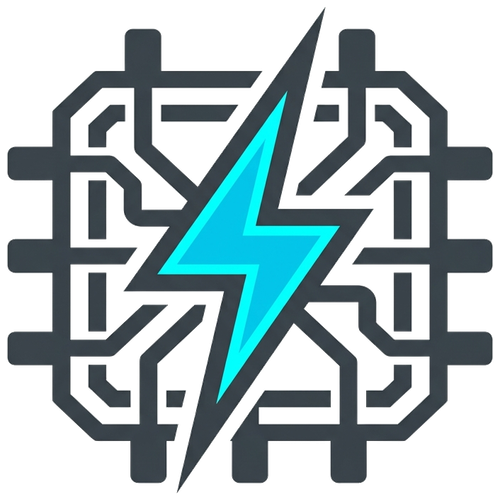
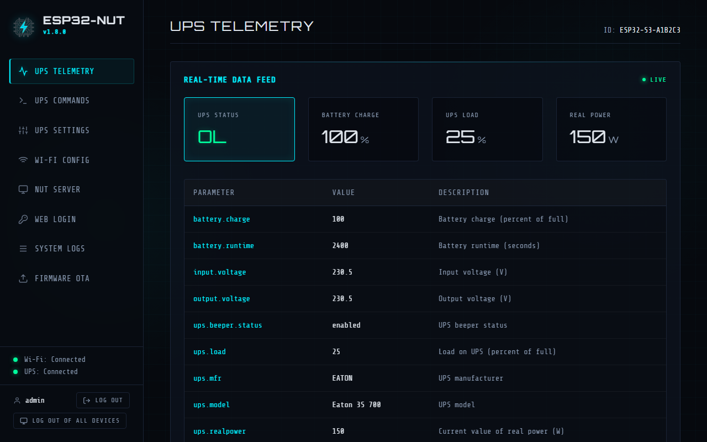
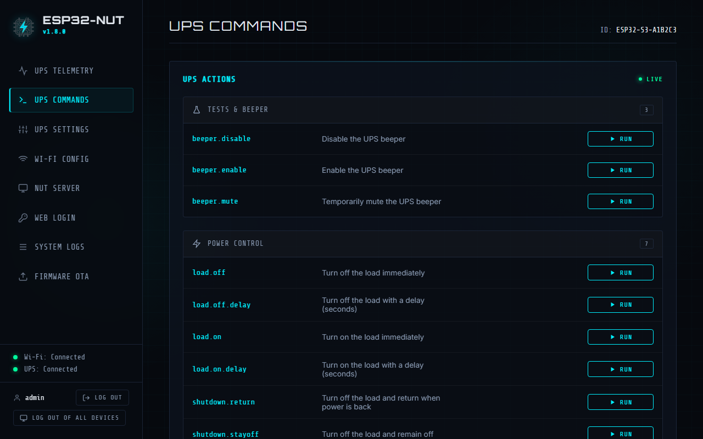
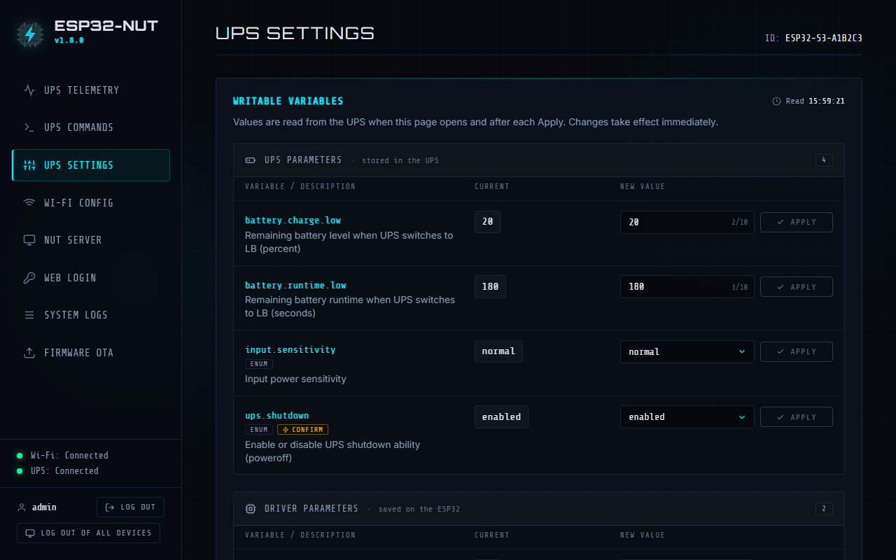
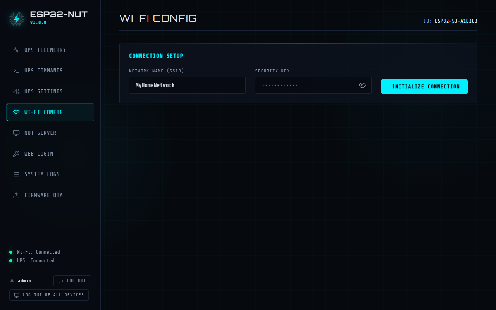
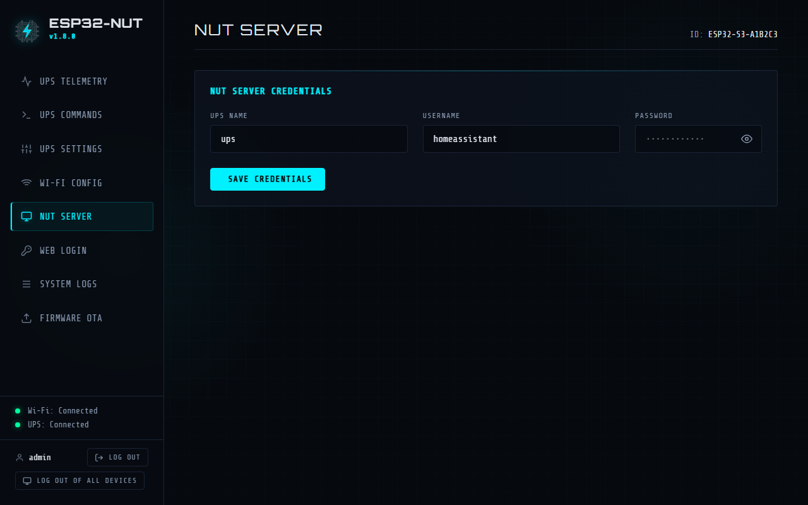
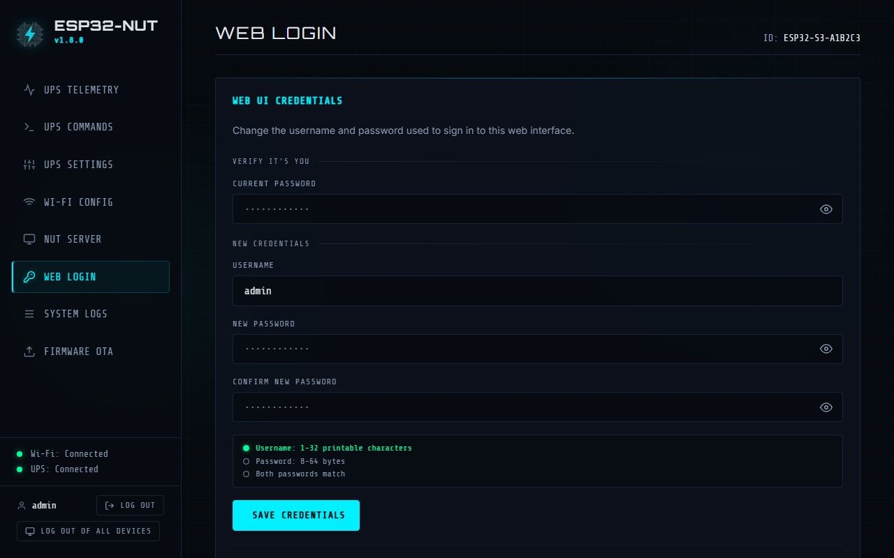
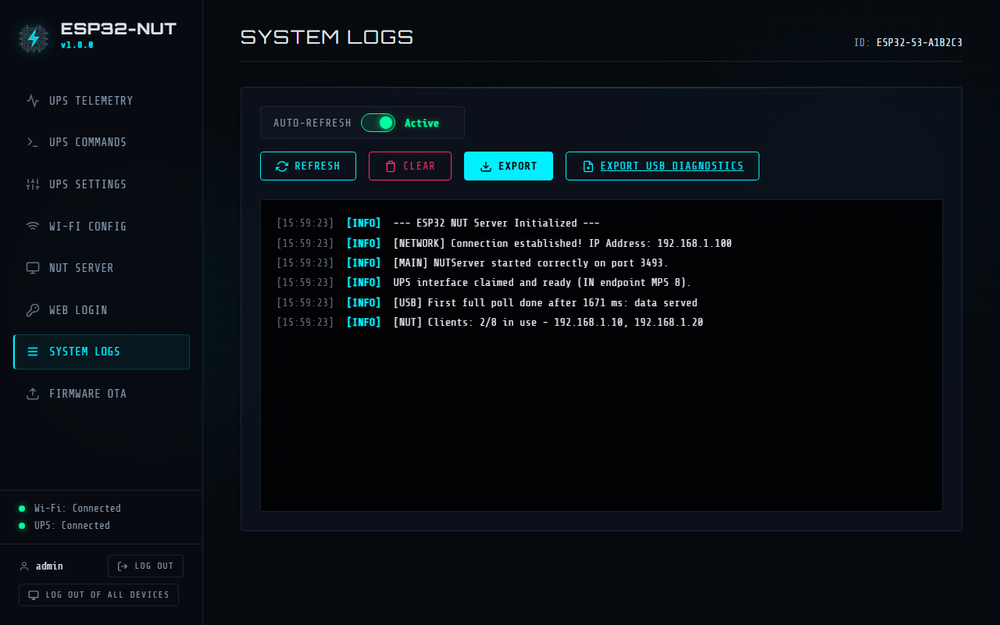
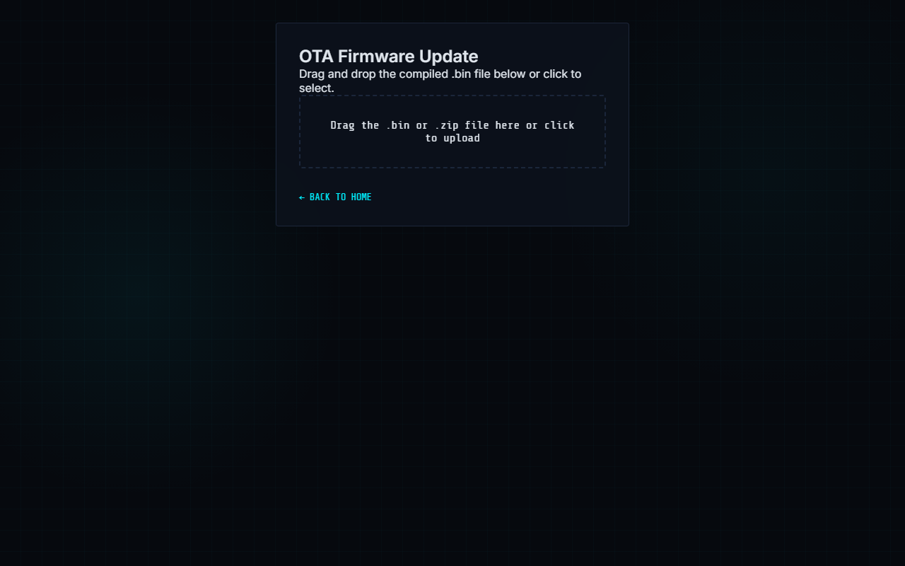
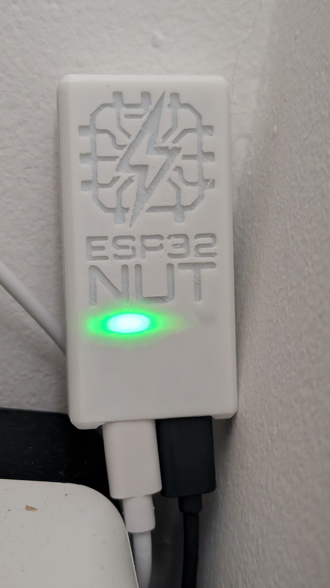

#  ESP32 NUT Server Bridge

*🇮🇹 [Leggi in Italiano](README.it.md)*

> [!WARNING]
> **Upgrading from v1.5.x or earlier? Install v1.6.x or later with the [web installer](https://maverick1982.github.io/esp32-nut/), not with an OTA update.**
>
> v1.6 adds a new flash partition (`coredump`) that keeps crash details for diagnostics. An OTA update cannot change the partition table: the board would work, but without that partition.
>
> When the installer asks **"Do you want to erase the device before installing?"**, leave **"Erase device" unchecked** and press **Next**: your Wi-Fi and NUT settings are preserved. Check it only if you want a clean install (the board then restarts in configuration mode as the `NUT_ESP32_Config` access point).
>
> After this one-time install, later updates can be installed via OTA again.

An open-source firmware for ESP32-S3 that acts as a standalone **Network UPS Tools (NUT) Server bridge** over Wi-Fi. It connects to a USB UPS (Eaton, APC, CyberPower, Powercom and more) via USB Host and exposes its data to your local network using the standard NUT protocol (port 3493) and a built-in Web Interface.

This allows you to easily integrate your USB-only UPS into Home Assistant, TrueNAS, Synology, or any other NUT-compatible client without needing a dedicated Raspberry Pi or PC running 24/7.

## 🌟 Features

- **Native USB Host Support**: Directly reads HID data from USB-compatible UPS devices (tested with Eaton, APC, CyberPower, Powercom).
- **NUT Server Protocol**: Implements the standard NUT protocol, making it instantly compatible with existing NUT clients (`upsc`, `upsmon`, Home Assistant, PeaNUT, …), up to 8 at the same time.
- **UPS Commands**: Battery and panel tests, beeper, load and shutdown commands, from the Web UI or with `upscmd` and Home Assistant, as with NUT's `usbhid-ups` driver.
- **UPS Settings**: Change the parameters your UPS allows (low battery thresholds, transfer points, battery date, shutdown delays, …) from the Web UI or with `upsrw`.
- **Web UI & Captive Portal**: Easy configuration of Wi-Fi and NUT credentials via a modern, responsive web interface, protected by a login.
- **Over-The-Air (OTA) Updates**: Flash new firmware versions directly from the web browser without touching the board.
- **Diagnostic LED**: Visual feedback for Wi-Fi and UPS connection status.

## 🔌 Supported UPS Devices

The firmware uses the official Network UPS Tools (NUT) HID mappings and supports multiple vendors automatically:

<b>Eaton</b> (Click to expand tested models)

- Eaton 3S series
- Eaton 5P 1U

<b>APC</b> (Click to expand tested models)

- APC Back-UPS CS 500
- APC BackUPS Pro 900
- APC Back-UPS XS 700U, XS 1500M
- APC Back-UPS BX750MI, BX1200MI
- APC Back-UPS ES 600M1, ES 700G
- APC Smart-UPS 750, 750L, 1000L

**Back-UPS BX series:** the APC firmware of these models stops answering USB requests at irregular intervals, often several times an hour (NUT on Linux is affected too). Since v1.7.1 the board restarts on its own a few seconds after each lockup, and the UPS status keeps updating until then. NUT clients may still see the data as stale for a few seconds. ([#60](https://github.com/maverick1982/esp32-nut/issues/60))

<b>CyberPower</b> (Click to expand tested models)

- CyberPower UT650EG, UT850EG
- CyberPower CP 1350C / CP1350AVRLCD
- CyberPower CP1500AVRLCDa
- CyberPower CP1500EPFCLCD, CP1600EPFCLCD
- CyberPower CP1500PFCLCDa
- CyberPower CP1500PFCRM2U
- CyberPower SL700U

<b>Powercom</b> (Click to expand tested models)

- Powercom SPD-750U

<b>Legrand</b> (Click to expand tested models)

- Legrand Keor PDU 800

<b>EcoFlow</b> (Click to expand untested / community-contributed models)

- EcoFlow River 3 Plus
- EcoFlow Delta 3 Plus

**Untested / community-contributed.** These models are recognized by the driver but have not been validated on real hardware yet.

<b>WalleCube</b> (Click to expand tested models)

- WalleCube Smart UPS W150

 

- **Generic / Other Brands**: If a UPS brand is not recognized, the system falls back to a generic driver that reads the standard USB HID values (battery charge and runtime, load, voltages, status). Brand-specific values may be missing. In that case, or to report a bug on an existing driver, use the **Export USB Diagnostics** button in the Web UI (System Logs tab) to download a diagnostic file (`usb_diagnostics.json`) and attach it when opening an issue on GitHub.

> [!NOTE]
> **USB HID Protocol Requirement:** This firmware currently supports only UPS models using the standard **USB HID Power Device Class** (`usbhid-ups`). UPS units communicating via USB-to-Serial protocols (such as Megatec/Q1, USB CDC/serial bridges, or proprietary serial protocols) are not currently supported.

## 📸 Screenshots

| UPS Telemetry | UPS Commands |
| :---: | :---: |
|  |  |

| UPS Settings | Wi-Fi Config |
| :---: | :---: |
|  |  |

| NUT Server | Web Login |
| :---: | :---: |
|  |  |

| System Logs | Firmware OTA |
| :---: | :---: |
|  |  |

## 🛠 Hardware Requirements & Wiring

- **ESP32-S3 Board**: An ESP32-S3 development board is **required** because it features native USB OTG Host capabilities. Standard ESP32 or ESP32-C3 will not work.
- **USB OTG Cable**: An adapter to plug the UPS USB cable into the ESP32.

### Typical Dual USB-C Board Setup (e.g., Generic ESP32-S3 DevKit)
Many generic ESP32-S3 boards with two USB-C ports have hidden solder pads on the back to enable Host mode. To achieve a clean setup without manually soldering wires to GPIOs:
1. **Solder the "USB-OTG" pads**: Find the two pads labeled `USB-OTG` on the back of the board and bridge them with solder. This routes 5V power to the `USB` port, enabling it to act as a Host to power the UPS USB interface.
2. **Solder the "RGB" pads (Optional)**: Bridge the `RGB` pads if you want to enable the built-in status LED.
3. **Power**: Connect a USB wall charger to the port labeled `COM` (or `UART`).
4. **Data**: Connect a USB-C OTG adapter to the port labeled `USB`, and plug the UPS into it.

### 3D Printed Case (Optional)

Turn your bare ESP32-S3 board into a finished product! We have designed a sleek 3D-printable case for this project.

Download the ready-to-print files from your favorite platform:
- [**Printables**](https://www.printables.com/model/1794471-case-esp32-nut-server-bridge)
- [**Thingiverse**](https://www.thingiverse.com/thing:7389257)

Source `.3mf` models, original `.f3d` CAD files, and additional photos are available in the [`hardware/case`](hardware/case) directory.

## 🚀 Getting Started

### 1. Flashing the Firmware

**Option A: Zero-Click Install via Browser (Recommended)**
You can install the firmware directly from your browser without downloading any tools!
👉 <a href="https://maverick1982.github.io/esp32-nut/" target="_blank">**Install via Browser**</a>

**Option B: Manual Build via PlatformIO**
1. Clone this repository.
2. Open the project folder in VSCode with the PlatformIO extension.
3. Connect your ESP32-S3 to your PC (using the UART/UART-Prog USB port).
4. Click **Build** and then **Upload**.

### 2. First Boot & Configuration
1. On first boot (or if no valid Wi-Fi configuration is saved), the ESP32 will create an Access Point named **`NUT_ESP32_Config`** (Password: `12345678`).
   > **Note:** To manually force Access Point mode (e.g., to change Wi-Fi settings), plug in the ESP32 and unplug it within 3 seconds. On the next boot, the ESP32 will start in Access Point mode. (The AP no longer activates automatically upon signal loss). If the saved configuration is valid and no device stays connected to the access point for 10 minutes, the board restarts in normal mode by itself; while a device is connected it stays in Access Point mode.
2. Connect your phone or PC to this Wi-Fi network.
3. A captive portal should automatically open. If not, navigate to `http://192.168.4.1`.
4. Enter your home Wi-Fi credentials and set your preferred NUT Server username/password.
5. Save and reboot.

### 3. 🔐 Web UI Login
The Web UI is protected by a username and password.
- **Create the credentials right away**: after updating to this firmware (or after a full flash), the first visit to the Web UI from your LAN shows only the **Create credentials** form. Whoever creates them first becomes the administrator, so do it as soon as the update is done.
- **Rules**: username of 1-32 printable characters, password of 8-64 bytes (8-64 plain ASCII characters; accented letters and emoji take 2-4 bytes each). The password is stored as a salted PBKDF2-SHA256 hash, never in clear text.
- **Everything requires login**: every page and API, firmware OTA update included.
- **Session**: it ends after 30 minutes without requests (an open UI keeps polling, so it stays signed in while it is open) and at every reboot. Use the **Log out** button in the sidebar to sign out.
- **Remember me**: tick it when you sign in and the session lasts 30 days, surviving reboots and firmware updates. At most 8 devices can be remembered: signing in on a 9th disconnects the oldest one.
- **Log out of all devices**: the sidebar button closes every session, remembered ones included.
- **Wrong passwords**: after 5 wrong passwords in a row, each further attempt has to wait 1 s, then 2, 4… up to 60 s. There is no permanent lockout, and NUT keeps running meanwhile.
- **Shutdown commands**: load and shutdown commands (`load.off`, `shutdown.*`, …) can be run from the **UPS Commands** page after a confirmation, in Access Point mode too.
- **UPS Settings**: the **UPS Settings** page lists the UPS parameters you can change, with their current values. Parameters that switch outlets, bypass or ECO mode ask for a confirmation first. Values saved on the ESP32 (`ups.delay.*`, outlet names) have a **Reset to default** button.
- **Separate from NUT**: the Web UI credentials are independent of the NUT credentials (NUT tab), which keep working as before for Home Assistant, PeaNUT, `upscmd`, etc.
- **Access Point mode** (double reset within 3 seconds): the Web UI is open without login, as before. It gives full access: credentials, NUT settings, OTA, UPS commands and settings. Keep the Access Point window short.
- ⚠️ **Plain HTTP**: the Web UI is served over HTTP, so passwords travel unencrypted on the network. Use it on a trusted LAN and don't reuse a password you use elsewhere.
- **Change credentials**: open the **Web Login** tab (sidebar, after **NUT Server**), enter the current password and the new username/password. Saving signs out every other device; the current one stays signed in.
- **Forgotten password**:
  1. Double reset within 3 seconds: the board starts as access point `NUT_ESP32_Config` (password `12345678`).
  2. Connect to it, open the Web UI and go to the **Web Login** tab.
  3. Set the new credentials with **Reset credentials** (no current password needed). All sessions are closed.
  4. Restart the board to go back to the home network (it also goes back by itself 10 minutes after the last device disconnects from the access point).
- ⚠️ **While in Access Point mode** the board is not on the home network, so NUT clients (Home Assistant, PeaNUT, …) cannot reach it. With a valid configuration the NUT server stays on, but only devices connected to the access point can reach it. Keep the recovery short.
- **Credentials are kept**: entering Access Point mode does not erase the Web UI credentials, and changing only the Wi-Fi settings keeps them too.
### 4. Usage
- Once connected to your home Wi-Fi, the ESP32 will grab an IP address from your DHCP server.
- **Web Dashboard**: Navigate to the ESP32's IP address in your browser to see real-time UPS stats (Battery level, Voltage, Load, etc.).
- **NUT Client**: Configure your Home Assistant or NAS to connect to the ESP32's IP on port `3493` using the credentials you defined.
- **UPS name**: NUT clients address the UPS by the **UPS Name** of the NUT tab (default `ups`), not by its model, e.g. `upsc ups@192.168.1.50`.
- **Up to 8 NUT clients** can be connected at the same time. Beyond that a new connection is rejected, and the System Log shows which addresses hold the connections. A client that disappears without closing its connection frees its slot after about 90 seconds.

## 🛠 Support the Project

This project is entirely open-source and free to use. 
If it helped you integrate your UPS into your smart home or server rack, please consider supporting its ongoing development! 

⭐ **The simplest way to support it is to star the repository on GitHub.** It costs nothing and helps other people find the project.

If you want to do more, donations will be explicitly used to purchase new UPS models for testing, ESP32 development boards, and other hardware tools necessary to improve the code and expand compatibility with a wider range of devices.

You can support the project via:

### 💻 Hardware donations: a development laptop

The biggest bottleneck for this project right now is my development machine: an 11-year-old laptop where every build and test cycle takes more than 10 minutes. A faster machine would directly mean quicker fixes, more test builds for the community and more supported UPS models.

If your company is retiring laptops, one of them could make a real difference here. Ideally:
- **16+ GB of RAM**
- **SSD** storage
- **CPU no older than 5–6 years**

It doesn't need to be new or perfect. If you can help, please write to **support [at] esp32-nut [dot] simplelogin [dot] com**.

Thank you to everyone who supports this project! 🚀

## 📄 License

This project is licensed under the **GNU General Public License v3.0 or later** - see the [LICENSE](LICENSE) file for details.

esp32-nut follows the behaviour of [Network UPS Tools](https://networkupstools.org/) (GPL v2 or later), and parts of its HID-to-NUT tables and driver logic are derived from the NUT sources. The derived source files carry the copyright notices of the NUT files they come from, and the [NOTICE](NOTICE) file lists the third-party components. Releases up to v1.8.0 were published under the MIT License and remain available under it.
