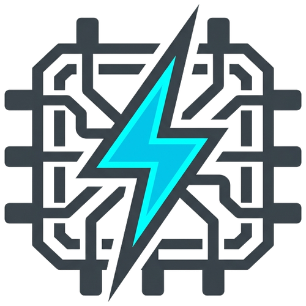
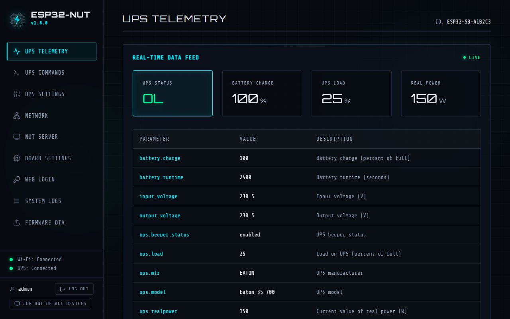
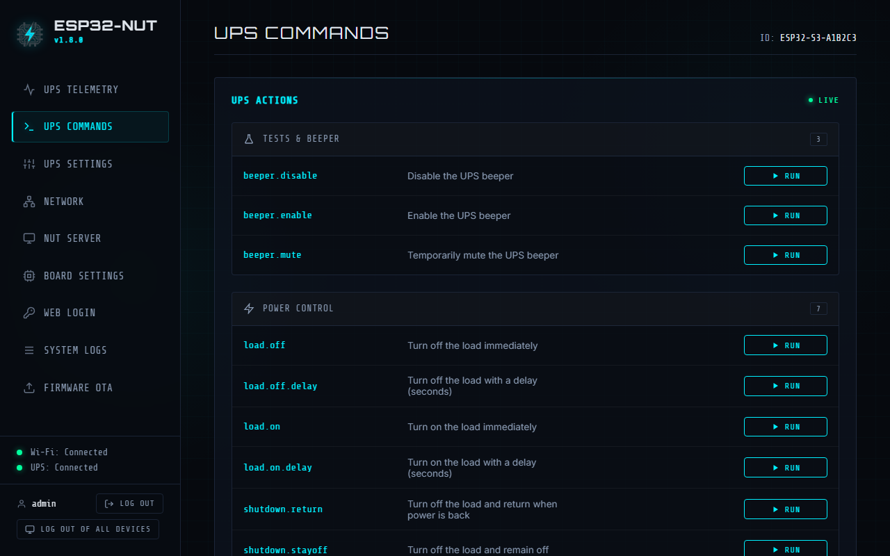
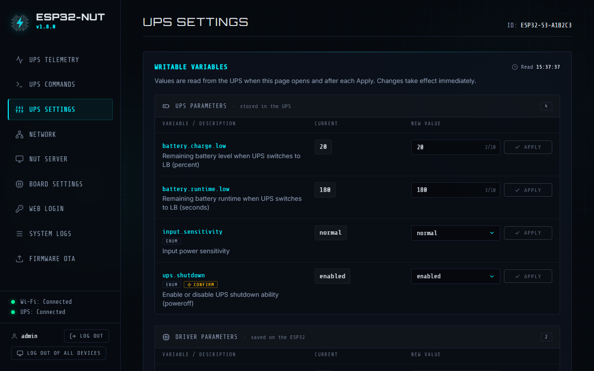
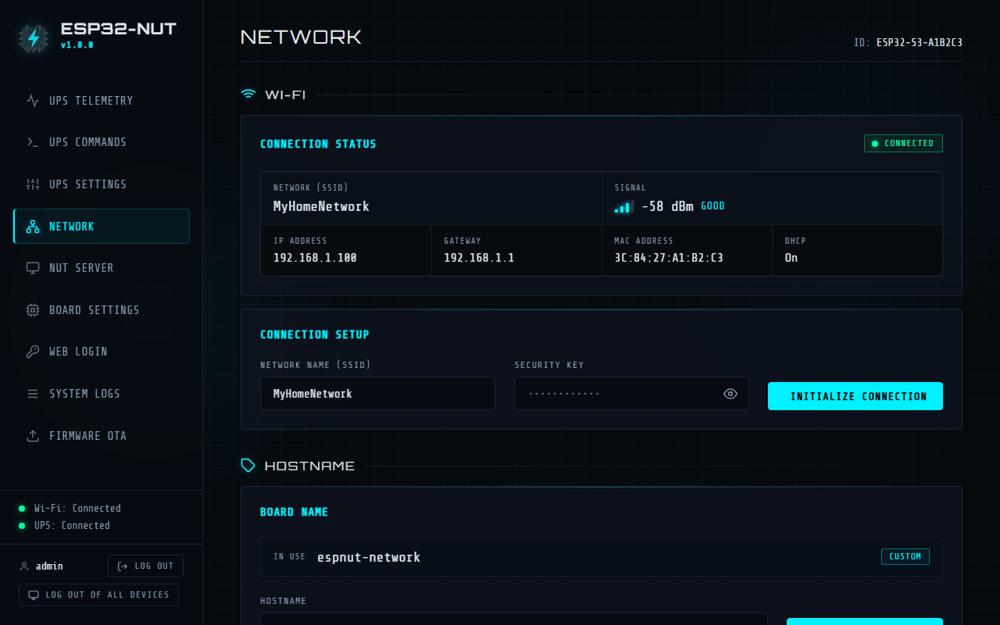
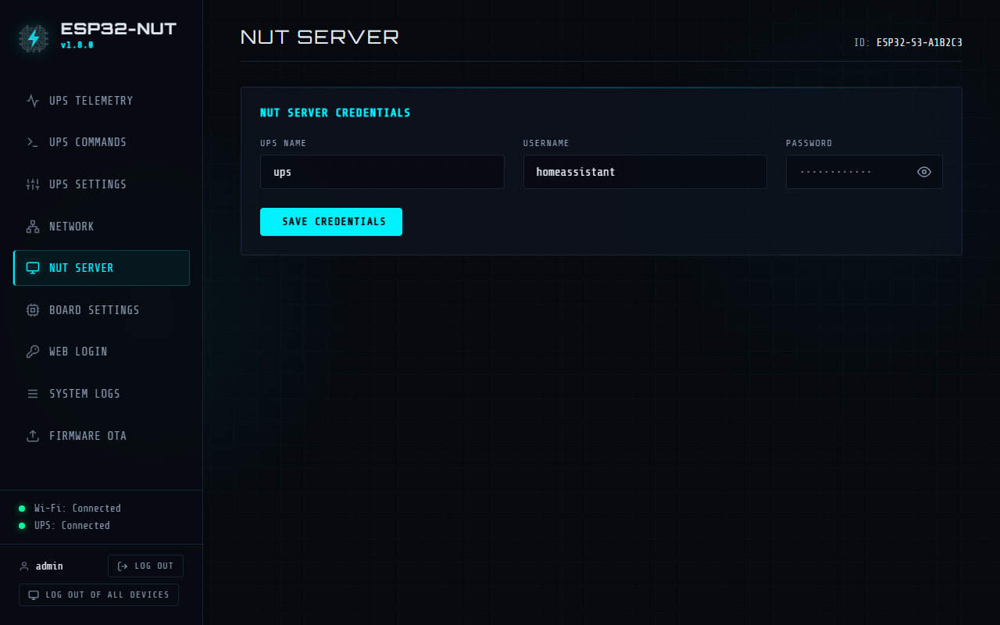
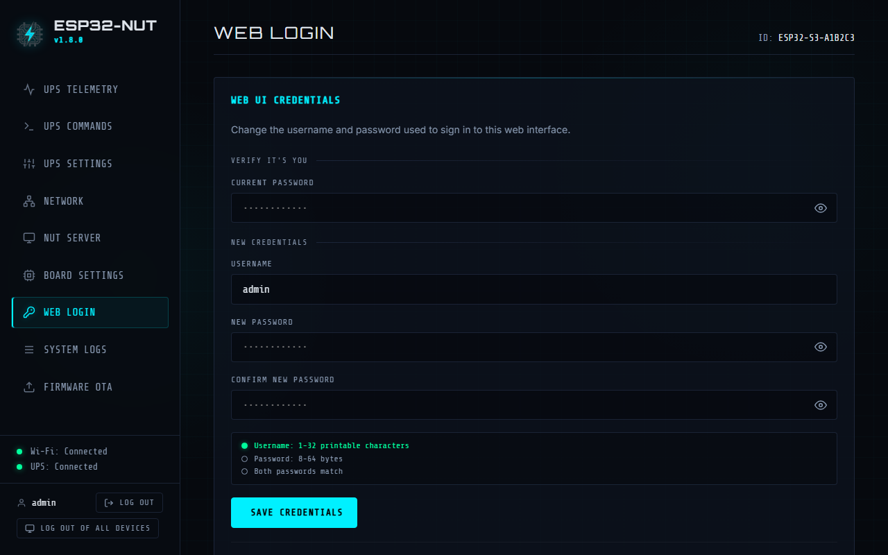
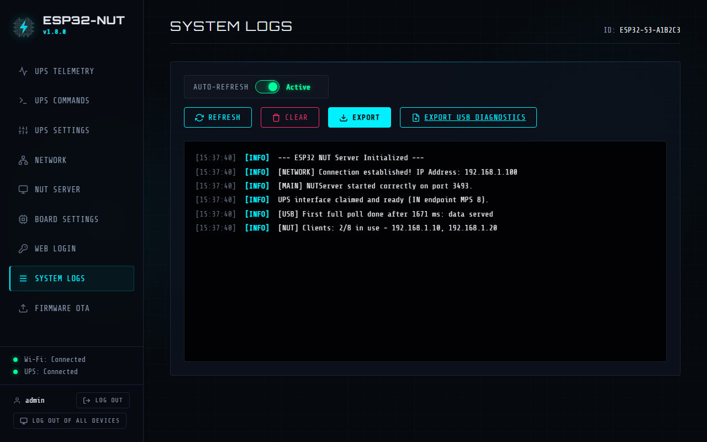
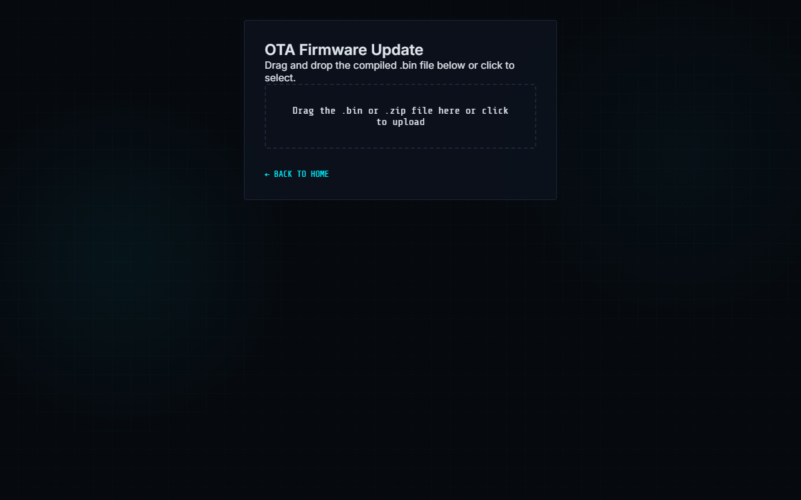
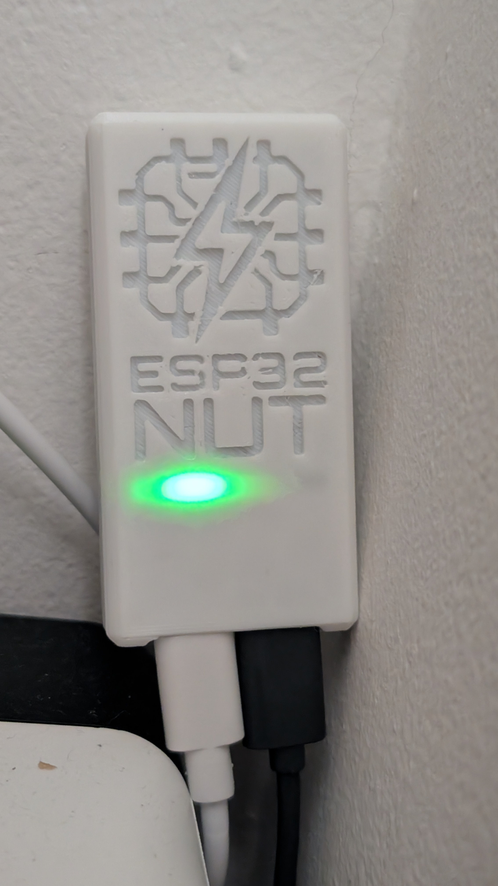

#  ESP32 NUT Server Bridge

*🇮🇹 [Leggi in Italiano](README.it.md)*

> [!WARNING]
> **Upgrading from v1.5.x or earlier? Install v1.6.x or later with the [web installer](https://maverick1982.github.io/esp32-nut/), not with an OTA update.**
>
> v1.6 adds a new flash partition (`coredump`) that keeps crash details for diagnostics. An OTA update cannot change the partition table: the board would work, but without that partition.
>
> When the installer asks **"Do you want to erase the device before installing?"**, leave **"Erase device" unchecked** and press **Next**: your Wi-Fi and NUT settings are preserved. Check it only if you want a clean install (the board then restarts in configuration mode as the `NUT_ESP32_Config` access point).
>
> After this one-time install, later updates can be installed via OTA again.

An open-source firmware for ESP32-S3 (Wi-Fi, or Ethernet with a W5500 module) and ESP32-P4 (Ethernet) boards that acts as a standalone **Network UPS Tools (NUT) Server bridge**. It connects to a USB UPS (Eaton, APC, CyberPower, Powercom and more) via USB Host and exposes its data to your local network using the standard NUT protocol (port 3493) and a built-in Web Interface.

This allows you to easily integrate your USB-only UPS into Home Assistant, TrueNAS, Synology, or any other NUT-compatible client without needing a dedicated Raspberry Pi or PC running 24/7.

## 🌟 Features

- **Native USB Host Support**: Directly reads HID data from USB-compatible UPS devices (tested with Eaton, APC, CyberPower, Powercom).
- **Megatec/Q1 UPS units**: Some UPS units that NUT drives with `nutdrv_qx` instead of `usbhid-ups` (Megatec/Q1 protocol family) work too, see [Q\* UPS units](#q-ups-units-megatecq1-nutdrv_qx).
- **NUT Server Protocol**: Implements the standard NUT protocol, making it instantly compatible with existing NUT clients (`upsc`, `upsmon`, Home Assistant, PeaNUT, …), up to 8 at the same time.
- **UPS Commands**: Battery and panel tests, beeper, load and shutdown commands, from the Web UI or with `upscmd` and Home Assistant, as with NUT's `usbhid-ups` driver.
- **UPS Settings**: Change the parameters your UPS allows (low battery thresholds, transfer points, battery date, shutdown delays, …) from the Web UI or with `upsrw`.
- **Custom NUT variables**: In the **NUT Server** tab, add variables the UPS does not report (e.g. `battery.date`) or replace a wrong value (e.g. `ups.model`), like `override.*` in `ups.conf`. Only NUT clients see them; the dashboard keeps the real UPS values.
- **Automatic Shutdown**: In **Board Settings**, the board can send `shutdown.default` to the UPS on low battery by itself, even with no NUT client connected (for UPSes that power a TV, an audio system or other devices without `upsmon`).
- **Web UI & Captive Portal**: A modern, responsive web interface protected by a login, with Wi-Fi setup through a captive portal on the ESP32-S3.
- **Network Page & Hostname**: The state of every link of the board (Wi-Fi or Ethernet), and the hostname the board sends to your router.
- **Remote Logging & Network Time**: Send the System Log to a syslog server (UDP, RFC 3164 or RFC 5424), with the time from an NTP server and the time zone of your choice.
- **USB Diagnostics**: One click in the **System Logs** tab exports a file with everything the UPS reports, to attach to a bug or compatibility report.
- **Over-The-Air (OTA) Updates**: Flash new firmware versions directly from the web browser without touching the board.
- **Status LED (ESP32-S3)**: Visual feedback for the network and UPS connection, with adjustable brightness.
- **ESP32-P4 with Ethernet**: A wired network, and PoE on the boards that have it, with ESP32-P4 boards such as the Waveshare ESP32-P4-ETH (see [ESP32-P4 (Ethernet)](#esp32-p4-ethernet)).
- **W5500 Ethernet on the ESP32-S3**: A wired network, and PoE on the boards that have it, with a W5500 SPI module or a board with one built in. In Automatic mode the board switches between cable and Wi-Fi by itself (see [Ethernet with a W5500 module](#ethernet-with-a-w5500-module-esp32-s3)).

## 🔌 Supported UPS Devices

The firmware uses the official Network UPS Tools (NUT) HID mappings and supports multiple vendors automatically:

<b>Eaton</b> (Click to expand tested models)

- Eaton 3S series
- Eaton 5P 1U
- Eaton Ellipse PRO 650, Ellipse ECO 650
- MGE Protection Center

<b>APC</b> (Click to expand tested models)

- APC Back-UPS CS 500
- APC BackUPS Pro 900
- APC Back-UPS Pro BN1050M, BGM2200
- APC Back-UPS XS 700U, XS 1500M
- APC Back-UPS BX750MI, BX1200MI
- APC Back-UPS BXR1200MI
- APC Back-UPS ES 600M1, ES 700G
- APC Smart-UPS 750, 750L, 1000L

**Back-UPS BX series:** the APC firmware of these models stops answering USB requests at irregular intervals, often several times an hour (NUT on Linux is affected too). The board recovers on its own a few seconds after each lockup, and the UPS status keeps updating until then. NUT clients may still see the data as stale for a few seconds. Sometimes the UPS also stops sending its status and keeps answering with frozen values until it is unplugged: after 15 seconds the board marks the data as stale and restarts, which frees the UPS. The newer BXR series is not affected. ([#60](https://github.com/maverick1982/esp32-nut/issues/60), [#138](https://github.com/maverick1982/esp32-nut/issues/138))

**Smart-UPS:** a USB request sometimes stays stuck. Since v1.14.0 the board switches its USB port off and on instead of restarting: the UPS comes back in a few seconds while the network, the web UI and the NUT server stay up. ([#78](https://github.com/maverick1982/esp32-nut/issues/78), [#120](https://github.com/maverick1982/esp32-nut/issues/120))

<b>CyberPower</b> (Click to expand tested models)

- CyberPower UT650EG, UT850EG
- CyberPower CP 1350C / CP1350AVRLCD
- CyberPower CP1500AVRLCDa
- CyberPower CP1500EPFCLCD, CP1600EPFCLCD
- CyberPower CP2000EIPFCRM2U
- CyberPower CP1500PFCLCDa
- CyberPower CP1500PFCRM2U
- CyberPower SL700U

<b>Powercom</b> (Click to expand tested models)

- Powercom SPD-750U

<b>Legrand</b> (Click to expand tested models)

- Legrand Keor PDU 800

<b>Powerwalker</b> (Click to expand tested models)

- Powerwalker VI 2200 SHL

<b>EcoFlow</b> (Click to expand untested / community-contributed models)

- EcoFlow River 3 Plus
- EcoFlow Delta 3 Plus

**Untested / community-contributed.** These models are recognized by the driver but have not been validated on real hardware yet.

<b>WalleCube</b> (Click to expand tested models)

- WalleCube Smart UPS W150

 

- **Generic / Other Brands**: If a UPS brand is not recognized, the system falls back to a generic driver that reads the standard USB HID values (battery charge and runtime, load, voltages, status). Brand-specific values may be missing. In that case, or to report a bug on an existing driver, use the **Export USB Diagnostics** button in the Web UI (System Logs tab) to download a diagnostic file (`usb_diagnostics.json`) and attach it when opening an issue on GitHub.

> [!TIP]
> **Is your UPS working but not in the list?** Let us know with the [UPS Compatibility Report](https://github.com/maverick1982/esp32-nut/issues/new?template=ups_report.yml) form: we'll add it to the tested models. Attaching the `usb_diagnostics.json` file helps us check future releases against your model.

### Q\* UPS units (Megatec/Q1, `nutdrv_qx`)

Some UPS units show up on USB as HID devices but send their data with a protocol of the Megatec/Q1 family: NUT drives them with `nutdrv_qx` instead of `usbhid-ups`. The board recognizes them by their USB ID, as NUT does, and uses the same protocols.

<b>Q* UPS units</b> (Click to expand tested models)

- VIDA Armour 1200VA (Protocol `hunnox`, novendor on)

- **Supported**: UPS units with USB ID `0001:0000` that NUT handles with the `krauler`, `fabula` or `hunnox` USB subdriver (for example Krauler, Fideltronik/MEC LUPUS, Hunnox and other units whose USB product name is `MEC0003`). Protocols: `megatec`, `megatec/old`, `mustek`, `zinto`, `hunnox`, `innovatae` and `q1`.
- **Settings**: if your UPS needs `protocol` or `novendor` in NUT's `ups.conf`, set them in **Board Settings** > **Q\* UPS driver** (see [More Settings](#5-more-settings)). `langid_fix` is applied by itself when the UPS needs it.
- **Not supported yet**: Q\* UPS units with other USB adapters (Cypress, Phoenix, Ippon, …, such as the Voltronic Power units with USB ID `0665:5161`). The board recognizes them and the Web UI says they are not supported yet.

> [!NOTE]
> UPS units with a USB-to-serial adapter (USB CDC, CH340, …) or a proprietary protocol are not supported.

## 📸 Screenshots

| UPS Telemetry | UPS Commands |
| :---: | :---: |
|  |  |

| UPS Settings | Network |
| :---: | :---: |
|  |  |

| NUT Server | Web Login |
| :---: | :---: |
|  |  |

| System Logs | Firmware OTA |
| :---: | :---: |
|  |  |

## 🛠 Hardware Requirements & Wiring

- **ESP32-S3 or ESP32-P4 Board**: An ESP32-S3 development board, or a supported ESP32-P4 board with Ethernet (see [ESP32-P4 (Ethernet)](#esp32-p4-ethernet)), is **required** because these chips have native USB OTG Host capabilities. Standard ESP32 or ESP32-C3 will not work.
- **W5500 Ethernet module (optional, ESP32-S3)**: for a wired network instead of Wi-Fi, an external W5500 module or a board with one built in (see [Ethernet with a W5500 module](#ethernet-with-a-w5500-module-esp32-s3)).
- **USB OTG Cable**: An adapter to plug the UPS USB cable into the ESP32-S3. The Waveshare ESP32-P4-ETH needs a different cable (see [ESP32-P4 (Ethernet)](#esp32-p4-ethernet)).
- **USB hubs and active extension cables**: a long USB cable with a built-in booster contains a USB hub. On the ESP32-P4 High-Speed port, a high-speed hub hides the UPS (a full-speed device): the ESP-IDF USB host stack cannot reach a full-speed device behind a high-speed hub. Use a passive cable, or put a full-speed-only USB isolator (ADuM3160-based) between the board and the cable. On the ESP32-S3, whose USB port is full-speed only, such a cable should work without the isolator (not tested). ([#113](https://github.com/maverick1982/esp32-nut/issues/113))

### Typical Dual USB-C Board Setup (e.g., Generic ESP32-S3 DevKit)
Many generic ESP32-S3 boards with two USB-C ports have hidden solder pads on the back to enable Host mode. To achieve a clean setup without manually soldering wires to GPIOs:
1. **Solder the "USB-OTG" pads**: Find the two pads labeled `USB-OTG` on the back of the board and bridge them with solder. This routes 5V power to the `USB` port, enabling it to act as a Host to power the UPS USB interface.
2. **Solder the "RGB" pads (Optional)**: Bridge the `RGB` pads if you want to enable the built-in status LED.
3. **Power**: Connect a USB wall charger to the port labeled `COM` (or `UART`).
4. **Data**: Connect a USB-C OTG adapter to the port labeled `USB`, and plug the UPS into it.

### ESP32-P4 (Ethernet)

An ESP32-P4 board with a wired Ethernet port can take the place of the ESP32-S3:
- **Supported boards**: Waveshare ESP32-P4-ETH (also the PoE version), Waveshare ESP32-P4-WIFI6-POE-ETH (tested, [#108](https://github.com/maverick1982/esp32-nut/issues/108); its ESP32-C6 Wi-Fi chip is not used, the board runs on Ethernet) and boards that follow the Espressif reference design (IP101 PHY). A board wired differently needs its own profile: open an issue.
- **UPS**: on the USB 2.0 High-Speed port (the 4-pin header J3 on the Waveshare ESP32-P4-ETH). On that board, the USB-C port is not a host port: an OTG adapter on it never sees the UPS. Use a JST 1.25 mm 4-pin to USB-A socket cable on J3, with all four wires: the UPS needs the 5V line to detect the host, and it does not show up with only GND, D- and D+ connected. ([#140](https://github.com/maverick1982/esp32-nut/discussions/140))
- **Network**: cable only. The address comes from DHCP and the host name is `esp32-nut-xxxxxx` (last 3 bytes of the MAC address). There is no Wi-Fi and no access point.
- **Two images, one per chip revision**:

| Image | Chip revision | Hardware tests |
| :--- | :--- | :--- |
| ESP32-P4 v3.1 or later | v3.1 and later (current production) | Tested by [rtadams89](https://github.com/rtadams89) on a v3.2 board, with a UPS ([#94](https://github.com/maverick1982/esp32-nut/issues/94)) |
| ESP32-P4 before v3 | v1.x (early boards) | Tested by [rtadams89](https://github.com/rtadams89) on a v1.3 board, with a UPS |

To find the revision, run `esptool chip-id` (`esptool.py chip_id` with esptool v4; the output says `Chip is ESP32-P4 (revision v1.3)`) or look for `chip revision: v1.3` in the serial boot log. Revisions v2.x and v3.0 are not supported by either image. An image for the wrong revision is refused, by the bootloader on a full install and by the board on an OTA update, so you can simply install the other one.

Thanks to [rtadams89](https://github.com/rtadams89) for the ESP32-P4 and Ethernet support.

### Ethernet with a W5500 module (ESP32-S3)

An ESP32-S3 can use wired Ethernet through a W5500 SPI module: an external module wired to the DevKit, or a board with a built-in W5500. There is no common pinout among these boards, so you always enter the pins yourself in the **Network** tab ([#64](https://github.com/maverick1982/esp32-nut/issues/64)).

- **Wires**: SCK, MOSI, MISO and CS are required; INT and RST are optional. Power the module from 3.3 V and connect GND. Without INT the board reads the chip at regular intervals; without RST there is no hardware reset of the module.
- **Pins that cannot be used** (the page refuses them): GPIO 19-20 (USB port of the UPS), 22-25 (not present on the ESP32-S3), 26-37 (flash and PSRAM), 43-44 (serial console), the status LED pins (48 and 38 on the DevKit) and the same GPIO in two fields.
- **Strapping pins** (GPIO 0, 3, 45, 46) are allowed with a warning: the board may not start if the module pulls one of them high or low at power-on.
- **Turning it on**: in the **Network** tab, section **Ethernet module (W5500)**, turn on **Use a W5500 module**, enter the GPIOs and save. The board restarts. The example values in grey (SCK 12, MOSI 11, MISO 13, CS 10, INT 9, RST 14) are six adjacent pins on the DevKitC-1 header, none of them a strapping pin.
- **Link to use**: with the module on, the W5500 section offers three choices. Only one link is active at a time, and the board has the same hostname on both (the one of the **Network** tab, or the default `esp32-nut-xxxxxx`).
  - **Automatic** (the default): Ethernet when the cable has a link and gets an address by DHCP, otherwise Wi-Fi. If the cable is unplugged while the board runs, it switches to Wi-Fi within 30 s, and goes back to Ethernet when the cable is connected again; each switch leaves a line in the **System Log**. If the cable has a link but the router gives it no address, the board stays on Wi-Fi and tries the cable again once it is replugged, or after 5 minutes. The switch needs a configured Wi-Fi network: it never goes to or from the access point.
  - **Ethernet**: cable only. Without a cable the board stays offline and says so in the **System Log**; it uses Wi-Fi only if the W5500 does not answer, so wrong pins cannot lock you out. Use the double reset to reach the access point.
  - **Wi-Fi**: Wi-Fi only, the W5500 is not used.
- **Same address on both links**: on a board with Wi-Fi the W5500 uses the Wi-Fi MAC address, so the router sees one device and gives it the same address by cable and by Wi-Fi. A DHCP reservation for that MAC address covers both links. The board never holds an address on both at once: going back to Ethernet it turns Wi-Fi off first, then asks for the address by cable, so it is offline for a few seconds.
- **After a switch** the NUT server closes the open sessions, so NUT clients (Home Assistant, upsmon) reconnect at once. The NUT, syslog and NTP settings apply to both links.
- **Fallback at startup**: in Automatic, if the W5500 does not answer (wrong pins, no module), the cable has no link within 5 s, or the router gives no address within 15 s, the board starts on Wi-Fi, or in access point mode when Wi-Fi is not configured. In Ethernet mode only a W5500 that does not answer sends the board to Wi-Fi. The **System Log** and the W5500 section say why. The double reset always starts the access point.
- **First start of a board with a built-in W5500**: the board starts in access point mode as usual. Enter the pins and turn the module on from the access point (or after setting up Wi-Fi): after the restart the board joins the network by cable.

**Known pins.** Verify them against your board's schematic; send a PR to add a board.

| Board | SCK | MOSI | MISO | CS | INT | RST | UPS USB port | Source |
| :--- | :-: | :-: | :-: | :-: | :-: | :-: | :--- | :--- |
| External module on an ESP32-S3 DevKit (Mickel4711) | 12 | 11 | 13 | 10 | 9 | 3 | `USB` port of the DevKit | [#94](https://github.com/maverick1982/esp32-nut/issues/94), tested ([#64](https://github.com/maverick1982/esp32-nut/issues/64)) |
| Waveshare ESP32-S3-ETH / ESP32-S3-POE-ETH | 13 | 11 | 12 | 14 | 10 | 9 | USB-C, not documented as a host port: an OTG adapter may be needed | [Waveshare wiki](https://www.waveshare.com/wiki/ESP32-S3-ETH), tested with the PoE module ([#64](https://github.com/maverick1982/esp32-nut/issues/64)) |
| LilyGO T-ETH-Lite S3 | 10 | 12 | 11 | 9 | 13 | 14 | Not known | [`utilities.h`](https://github.com/Xinyuan-LilyGO/LilyGO-T-ETH-Series) (the wiki gives different values) |

### 3D Printed Case (Optional)

Turn your bare ESP32-S3 board into a finished product! We have designed a sleek 3D-printable case for this project.

Download the ready-to-print files from your favorite platform:
- [**Printables**](https://www.printables.com/model/1794471-case-esp32-nut-server-bridge)
- [**Thingiverse**](https://www.thingiverse.com/thing:7389257)

Source `.3mf` models, original `.f3d` CAD files, and additional photos are available in the [`hardware/case`](hardware/case) directory.

## 🚀 Getting Started

### 1. Flashing the Firmware

**Option A: Zero-Click Install via Browser (Recommended)**
You can install the firmware directly from your browser without downloading any tools!
👉 <a href="https://maverick1982.github.io/esp32-nut/" target="_blank">**Install via Browser**</a>

The installer has one button for ESP32-S3 boards and two for ESP32-P4 boards, one per chip revision (see [ESP32-P4 (Ethernet)](#esp32-p4-ethernet)).

If the installer finds the board but stops with "Failed to initialize":
- **ESP32-P4 v3.1 or later**: the installer cannot flash these chips yet. Its flashing library (esptool-js 0.6, inside ESP Web Tools 10.4.0) does not power on their flash memory in download mode. Write the release package with esptool instead (see **Release packages** below). ([#136](https://github.com/maverick1982/esp32-nut/issues/136))
- **Other boards**: the board did not enter download mode by itself. Hold the **BOOT** button while you click **Install** (or while you plug in the USB cable) and release it once the installer connects. If it still fails, use esptool.

**Option B: Manual Build via PlatformIO**
1. Clone this repository.
2. Open the project folder in VSCode with the PlatformIO extension.
3. Connect your ESP32-S3 to your PC (using the UART/UART-Prog USB port).
4. Click **Build** and then **Upload**.

The PlatformIO environments are `esp32-s3-standard`, `esp32-p4-eth` (ESP32-P4 v3.1 or later) and `esp32-p4-eth-v1` (ESP32-P4 before v3).

**Release packages**
Every [release](https://github.com/maverick1982/esp32-nut/releases) has one zip per board: `esp32-nut-vX.Y.Z.zip` (ESP32-S3), `esp32-nut-vX.Y.Z-esp32-p4-eth.zip` (ESP32-P4 v3.1 or later) and `esp32-nut-vX.Y.Z-esp32-p4-eth-v1.zip` (ESP32-P4 before v3). Inside, `firmware.factory.bin` is the complete image to write at `0x0` (for example `esptool write-flash 0x0 firmware.factory.bin`, or `esptool.py write_flash 0x0 firmware.factory.bin` with esptool v4), and `README.txt` explains the other files. For an OTA update, upload the zip or its `firmware.bin`.

### 2. First Boot & Configuration

> [!NOTE]
> **ESP32-P4 (Ethernet):** there is no access point and no Wi-Fi setup. Plug in the network cable: without it the board has no network at all and just waits for the link (the serial log repeats `No Ethernet link for N s` every minute). With the cable, the board gets its address by DHCP and starts with the default NUT settings (no NUT credentials, UPS name `ups`): NUT clients can read the data, and to run commands from Home Assistant or `upscmd` set the NUT credentials in the **NUT Server** tab. Find it in your router as `esp32-nut-xxxxxx`, open its address in the browser and continue with the Web UI login below. If you lose the web credentials, a double reset (power the board off and on again within 3 seconds) opens a 10-minute window in which the Web UI lets you create new ones without the current password.

1. On first boot (or if no valid Wi-Fi configuration is saved), the ESP32 will create an Access Point named **`NUT_ESP32_Config`** (Password: `12345678`).
   > **Note:** To manually force Access Point mode (e.g., to change Wi-Fi settings), plug in the ESP32 and unplug it within 3 seconds. On the next boot, the ESP32 will start in Access Point mode. (The AP no longer activates automatically upon signal loss). If the saved configuration is valid and no device stays connected to the access point for 10 minutes, the board restarts in normal mode by itself; while a device is connected it stays in Access Point mode.
2. Connect your phone or PC to this Wi-Fi network.
3. A captive portal should automatically open. If not, navigate to `http://192.168.4.1`.
4. Open the **Network** tab, type your Wi-Fi name and password in **Connection Setup** and press **Initialize Connection**. The board saves them and restarts on your network.
5. Find the board in your router as `esp32-nut-xxxxxx` and open its address in the browser.

### 3. 🔐 Web UI Login
The Web UI is protected by a username and password.
- **Create the credentials right away**: after updating to this firmware (or after a full flash), the first visit to the Web UI from your LAN shows only the **Create credentials** form. Whoever creates them first becomes the administrator, so do it as soon as the update is done.
- **Rules**: username of 1-32 printable characters, password of 8-64 bytes (8-64 plain ASCII characters; accented letters and emoji take 2-4 bytes each). The password is stored as a salted PBKDF2-SHA256 hash, never in clear text.
- **Everything requires login**: every page and API, firmware OTA update included.
- **Session**: it ends after 30 minutes without requests (an open UI keeps polling, so it stays signed in while it is open) and at every reboot. Use the **Log out** button in the sidebar to sign out.
- **Remember me**: tick it when you sign in and the session lasts 30 days, surviving reboots and firmware updates. At most 8 devices can be remembered: signing in on a 9th disconnects the oldest one.
- **Log out of all devices**: the sidebar button closes every session, remembered ones included.
- **Wrong passwords**: after 5 wrong passwords in a row, each further attempt has to wait 1 s, then 2, 4… up to 60 s. There is no permanent lockout, and NUT keeps running meanwhile.
- **Shutdown commands**: load and shutdown commands (`load.off`, `shutdown.*`, …) can be run from the **UPS Commands** page after a confirmation, in Access Point mode too.
- **UPS Settings**: the **UPS Settings** page lists the UPS parameters you can change, with their current values. Parameters that switch outlets, bypass or ECO mode ask for a confirmation first. Values saved on the ESP32 (`ups.delay.*`, outlet names) have a **Reset to default** button.
- **Separate from NUT**: the Web UI credentials are independent of the NUT credentials (NUT tab), which keep working as before for Home Assistant, PeaNUT, `upscmd`, etc.
- **Access Point mode** (double reset within 3 seconds): the Web UI is open without login, as before. It gives full access: credentials, NUT settings, OTA, UPS commands and settings. Keep the Access Point window short.
- ⚠️ **Plain HTTP**: the Web UI is served over HTTP, so passwords travel unencrypted on the network. Use it on a trusted LAN and don't reuse a password you use elsewhere.
- **Change credentials**: open the **Web Login** tab (sidebar, after **Board Settings**), enter the current password and the new username/password. Saving signs out every other device; the current one stays signed in.
- **Forgotten password**:
  1. Double reset within 3 seconds: the board starts as access point `NUT_ESP32_Config` (password `12345678`).
  2. Connect to it, open the Web UI and go to the **Web Login** tab.
  3. Set the new credentials with **Reset credentials** (no current password needed). All sessions are closed.
  4. Restart the board to go back to the home network (it also goes back by itself 10 minutes after the last device disconnects from the access point).
- ⚠️ **While in Access Point mode** the board is not on the home network, so NUT clients (Home Assistant, PeaNUT, …) cannot reach it. With a valid configuration the NUT server stays on, but only devices connected to the access point can reach it. Keep the recovery short.
- **Credentials are kept**: entering Access Point mode does not erase the Web UI credentials, and changing only the Wi-Fi settings keeps them too.
### 4. Usage
- Once connected to your home network, the board gets an IP address from your DHCP server. The **Network** tab shows it; to always find the board at the same address, reserve one for its MAC address in the router.
- **Web Dashboard**: Navigate to the board's IP address in your browser to see real-time UPS stats (Battery level, Voltage, Load, etc.).
- **NUT Client**: Configure your Home Assistant or NAS to connect to the board's IP on port `3493`.
- **NUT credentials**: set them in the **NUT Server** tab, together with the UPS name. They apply at once, with no restart: connected NUT clients are disconnected and reconnect with the new settings. NUT clients need them to run commands and change settings (`upscmd`, `upsrw`, Home Assistant commands); reading the data works without them, as with NUT. They are optional: with no NUT credentials set, NUT clients can only read the data, and commands and setting changes are refused (`ERR ACCESS-DENIED`), as NUT does with no users in `upsd.users`. Username and password go together; leave Password empty to keep the current one, and use **Remove NUT credentials** to clear both.
- **UPS name**: NUT clients address the UPS by the **UPS Name** of the NUT tab (default `ups`), not by its model, e.g. `upsc ups@192.168.1.50`.
- **Up to 8 NUT clients** can be connected at the same time. Beyond that a new connection is rejected, and the System Log shows which addresses hold the connections. A client that disappears without closing its connection frees its slot after about 90 seconds.
- **No fresh data**: when the UPS is not answering (disconnected, USB link being recovered), NUT clients get `ERR DATA-STALE`, as with NUT.

### 5. More Settings
- **Hostname** (**Network** tab): the name the board sends to your router, 1-32 letters, digits and hyphens. Empty means the default `esp32-nut-xxxxxx`. The board restarts to apply it.
- **W5500 Ethernet module** (**Network** tab, ESP32-S3, off by default): the pins of a W5500 wired to the board and the link to use (Automatic, Ethernet, Wi-Fi), see [Ethernet with a W5500 module](#ethernet-with-a-w5500-module-esp32-s3). The board restarts to apply them.
- **Automatic shutdown** (**Board Settings** tab, off by default): when the UPS is on battery and reports low battery (`OB LB`), the board sends `shutdown.default` once, even with no NUT client connected, and not again until the UPS is back on line. The threshold is `battery.charge.low` / `battery.runtime.low` of the UPS (**UPS Settings** tab). Whether the UPS turns back on when power returns depends on the model.
- **Time** (**Board Settings** tab): NTP on by default (`pool.ntp.org`, UTC), with a time zone list with automatic daylight saving time. The time is only shown in the System Log and written in the syslog lines; without Internet access the board works as before.
- **Status LED** (**Board Settings** tab, ESP32-S3): turn it off or choose its brightness.
- **Q\* UPS driver** (**Board Settings** tab, only with a [Q\* UPS](#q-ups-units-megatecq1-nutdrv_qx) connected): the protocol the board detected, and the `protocol` and `novendor` options of NUT's `ups.conf`. Leave Protocol on **Automatic** unless NUT needs a specific one for your model: some protocols answer the same probe (`hunnox` is detected as `megatec`), as in NUT. Applied at once, with no restart.
- **Custom variables** (**NUT Server** tab): up to 16 values that NUT clients see in place of the UPS ones, or as extra variables. `ups.status`, `ups.status.*`, `device.type` and `driver.parameter.*` cannot be set, and a writable variable with a custom value becomes read-only.
- **Remote logging** (**System Logs** tab, off by default): send the System Log to a syslog server over UDP, with server, port (default 514), format, facility, minimum level and rate limit. UDP syslog is not encrypted: anyone on the LAN can read the lines.
- **Automatic recovery**: when the UPS stops answering, the board recovers the USB link by itself: first the USB interface, then a power cycle of the USB port, then a restart (at once, then after 1, 5 and 15 minutes). After 4 restarts in a row without the UPS it stops restarting (degraded mode) and the yellow box at the top of the web UI says what to do.

## 🛠 Support the Project

This project is entirely open-source and free to use. 
If it helped you integrate your UPS into your smart home or server rack, please consider supporting its ongoing development! 

⭐ **The simplest way to support it is to star the repository on GitHub.** It costs nothing and helps other people find the project.

If you want to do more, donations will be explicitly used to purchase new UPS models for testing, ESP32 development boards, and other hardware tools necessary to improve the code and expand compatibility with a wider range of devices.

You can support the project via:

### 💻 Hardware donations: a development laptop

The biggest bottleneck for this project right now is my development machine: an 11-year-old laptop where every build and test cycle takes more than 10 minutes. A faster machine would directly mean quicker fixes, more test builds for the community and more supported UPS models.

If your company is retiring laptops, one of them could make a real difference here. Ideally:
- **16+ GB of RAM**
- **SSD** storage
- **CPU no older than 5–6 years**

It doesn't need to be new or perfect. If you can help, please write to **support [at] esp32-nut [dot] simplelogin [dot] com**.

Thank you to everyone who supports this project! 🚀

## 📄 License

This project is licensed under the **GNU General Public License v3.0 or later** - see the [LICENSE](LICENSE) file for details.

esp32-nut follows the behaviour of [Network UPS Tools](https://networkupstools.org/) (GPL v2 or later), and parts of its HID-to-NUT tables and driver logic are derived from the NUT sources. The derived source files carry the copyright notices of the NUT files they come from, and the [NOTICE](NOTICE) file lists the third-party components. Releases up to v1.8.0 were published under the MIT License and remain available under it.
