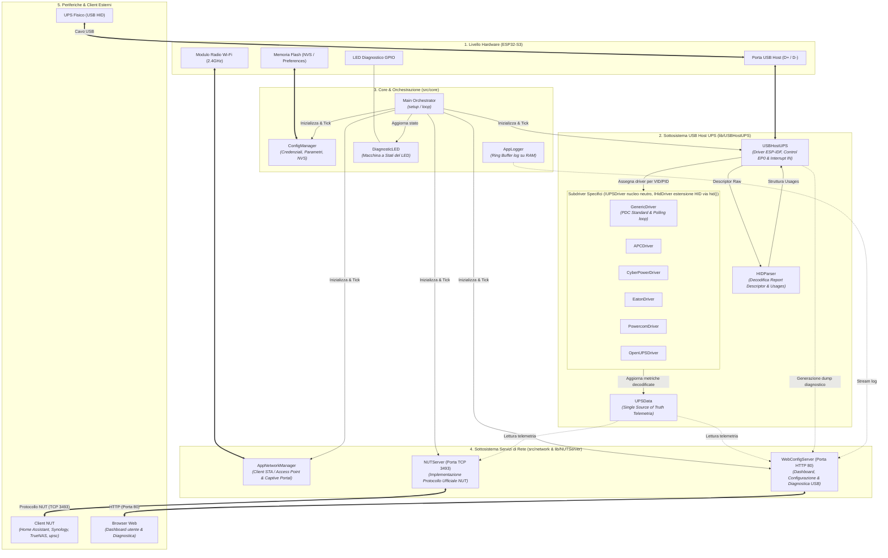
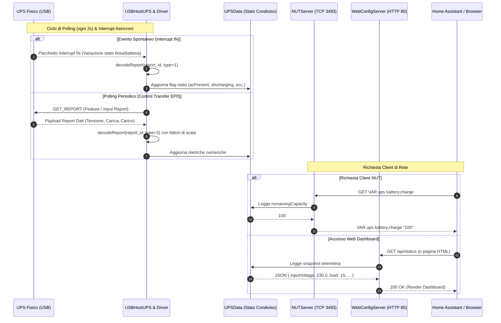

# Architettura Logica del Sistema ESP32-NUT

Questo documento descrive l'architettura software e logica del firmware **ESP32-NUT**, dettagliando i livelli funzionali, i flussi di dati e l'interazione tra i vari moduli.

---

## 1. Schema Architetturale Generale

---

## 2. Diagramma di Sequenza: Flusso di Polling & Rete

Il seguente diagramma illustra come i dati viaggiano dall'UPS fisico fino ai client di monitoraggio esterni (es. Home Assistant o interfaccia Web).

---

## 3. Descrizione Funzionale dei Livelli

| Livello | Responsabilità Principali | Componenti Chiave |
| :--- | :--- | :--- |
| **1. Hardware** | Connettività fisica USB Host, modulo radio Wi-Fi, pinout GPIO LED, memoria Flash non volatile. | ESP32-S3 SoC, NVS, GPIO LED |
| **2. USB Host & Driver** | Gestione stack USB host ESP-IDF, enumerazione periferiche, parsing alberi HID, elaborazione quirks, driver specializzati per marca/modello e memorizzazione telemetria. | `USBHostUPS`, `HIDParser`, `IUPSDriver`, `IHidDriver`, `DriverDispatch`, `UPSData` |
| **3. Core & Orchestrazione** | Ciclo di vita applicativo, fallback fail-safe (Access Point / Station), log di sistema su ring buffer RAM e indicazione visiva tramite LED diagnostico. | `main.cpp`, `ConfigManager`, `AppLogger`, `DiagnosticLED` |
| **4. Servizi di Rete** | Gestione interfaccia di rete (Wi-Fi STA o SoftAP con Captive Portal), server conforme al protocollo Network UPS Tools (NUT) su TCP 3493 e Web Server di configurazione/diagnostica su porta 80. | `AppNetworkManager`, `NUTServer`, `WebConfigServer` |
| **5. Client Esterni** | Dispositivi UPS monitorati, piattaforme di domotica e automazione (Home Assistant), NAS (Synology, QNAP, TrueNAS), client CLI `upsc` e browser web dell'utente. | Client NUT, Dashboard Web, UPS |

**Driver: nucleo ed estensioni per famiglia (ADR 0013, US-131).** `IUPSDriver` contiene solo ciò che l'host chiede a ogni driver, di qualunque famiglia di protocollo: nome, `setup()`, `poll()`, primo poll completo, stringhe del dispositivo, `control()`, ritardi e valori lato driver. I metodi della famiglia HID (decodifica dei report, piano dei SET VAR, lunghezze delle richieste, watchdog degli INPUT, beeper, righe dei comandi, percorsi di `ups.delay.*`) stanno in `IHidDriver`, raggiunta solo con `hid()`, che vale `nullptr` per un driver di un'altra famiglia. `USBHostUPS` arriva a quei metodi solo attraverso `DriverDispatch.h`, l'unico punto dell'host che chiama `hid()`: un driver non HID non riceve mai una chiamata HID.

**Scelta della famiglia all'aggancio (ADR 0013 sezione 2, US-132).** `USBHostUPS::claimInterface()` sceglie la famiglia prima di leggere il report descriptor, con `DriverRegistry::match()` su VID, PID e stringhe: prima le righe HID esplicite, poi le righe Q* (copia di `qx_usb_id[]` di `nutdrv_qx`), infine il fallback HID generico, tenuto solo per un'interfaccia con pagine UPS (0x84) o Battery (0x85). Un UPS Q* tiene l'interfaccia 0 senza pipe IN, cache dei report, watchdog degli INPUT né lettura diagnostica; finché il driver Q* non c'è, `isConnected()` resta falso e la Web UI lo mostra come "Not supported yet" tramite `IUpsSource::unsupportedDevice()`.

**Motore Q* (ADR 0013 sezione 4, US-133).** I protocolli Q* sono copie riga per riga dei file `nutdrv_qx_<nome>.c` di NUT: una tabella `static const QxItem[]` (le colonne di `item_t` senza `answer`/`value`) e un `QxSubdriver` per protocollo (`QxMegatec.cpp`, `QxQ1.cpp`, `QxMustek.cpp`, `QxMegatecOld.cpp`, `QxZinto.cpp`, `QxInnovatae.cpp`, elencati in `QxProtocols.h`). Le funzioni comuni dei protocolli derivati da Megatec (claim, bit di stato, comandi di spegnimento e test) sono in `QxBlazerCommon`, portato una volta da `nutdrv_qx_blazer-common.c`. `QxEngine` esegue una tabella su un `IQxTransport` (un comando, una risposta, come i `*_command()` di NUT) con le fasi di `nutdrv_qx.c`: `claim()`, `initUps()`, `initInfo()`, poi `updateInfo()` a ogni poll (righe statiche all'avvio, semi-statiche ogni 30 s, stato a ogni poll; dati stale dopo i fallimenti consecutivi di NUT). Lo stato per riga (flag) e i buffer di lavoro stanno nell'istanza, le tabelle restano costanti. I bit di stato finiscono negli stessi flag `ups.status.*` dei driver HID, quindi `ups.status` ha un solo calcolo. È logica pura, provata in nativo con le tabelle `testing_t` di NUT (`test_qx_engine`, `test_qx_protocols`); l'host la usa tramite `QxDriver` (US-136).

**Riconoscimento del protocollo Q* (ADR 0013 sezione 4, US-134).** `QxProber` porta `subdriver_matcher()` di NUT: prova i protocolli di `QX_SUBDRIVER_LIST` nell'ordine di `subdriver_list[]` (i protocolli non ancora portati sono commenti al loro posto, l'ordine non cambia), ciascuno fino a `QX_MAXTRIES` (3) volte con il suo claim. Diversamente da NUT fa un solo tentativo per chiamata di `step()`, così il task di poll non resta fermo su un intero giro, e un giro senza esito non è fatale: scrive una volta per aggancio `[Q*] Device not supported!` e riparte dopo 30 s, con intervallo raddoppiato fino a 10 minuti. Con un protocollo forzato (`configure()`, il `protocol` di `ups.conf`, nome fino al primo spazio senza maiuscole: `megatec/old`, `q1`, …) prova solo quello. Al riconoscimento scrive `[Q*] Using protocol: <nome versione>` e consegna il motore con `takeEngine()`, già passato dal claim; il chiamante prosegue con `initUps()`/`initInfo()`. Un solo `QxEngine` (circa 4 KB) per aggancio, riportato con `QxEngine::reset()` allo stato iniziale per ogni protocollo provato, così un giro non alloca e libera memoria a ogni protocollo. Tempo e log arrivano dal chiamante, `QxDriver` (US-136), che lo esegue sui dati ombra. Conseguenza dell'ordine di NUT: un UPS che risponde solo a `Q1` viene preso da `innovatae` (claim con il solo `Q1`, prima di `q1`), come in NUT; `q1` si raggiunge solo forzandolo.

**Comandi e SET VAR Q* (ADR 0013 sezione 4, US-135).** `QxEngine::instcmd()` e `QxEngine::setvar()` (`QxEngineControl.cpp`) portano `instcmd()` e `setvar()` di `nutdrv_qx.c` con gli stessi esiti: il comando della riga `QX_FLAG_CMD` con il suo preprocess (per esempio `S.5R0003` per `shutdown.return` con i ritardi predefiniti), i ripieghi su `load.*.delay`, la risposta confrontata con `accepted`/`rejected` del protocollo, e per SET VAR i controlli di intervallo, enumerazione e lunghezza da `info_rw`. `ups.delay.*` resta una variabile lato server, come in NUT. `QxControl` è l'`IUpsControl` dei driver Q*: come `HidControl` è statico e senza stato, ma non tocca il motore. Passa dai tre metodi neutri di `IUpsControlPort` (`driverCommands`, `runDriverCommand`, `runDriverSetVariable`, che di default non offrono nulla, quindi l'host HID non cambia) e non usa mai l'accesso HID della porta (verificato da `test_hid_transport`). Gestisce da sé solo `shutdown.default`, che porta `upsdrv_shutdown()`: `shutdown.stop` e poi `shutdown.return`, fino a 3 tentativi ciascuno, un tentativo per riga di log. L'host esegue questi metodi nel task di poll (paragrafo seguente); li provano `test_qx_control` con una porta finta e `test_qx_driver` con il driver intero.

**Driver Q* nell'host (ADR 0013 sezioni 2, 3 e 5, US-136).** Quando `DriverRegistry` indica una riga Q* con un trasporto portato in `QxUsbTransports` (oggi krauler, fabula e hunnox, US-137), `claimQxInterface()` crea il `QxUsbTransport` del sottodriver e un `QxDriver` (`IUPSDriver` con l'estensione `qx()`, driver `nutdrv_qx`), e apre la pipe IN solo se il trasporto la chiede. Tutto il lavoro USB resta nel task di poll e nessun lock applicativo è tenuto durante un trasferimento: le primitive di `USBHostUPS::QxUsbPort` (`IQxUsbPrimitives`: SET_REPORT, descrittore stringa, lettura e svuotamento della pipe IN) sono chiamate solo dal task di poll e rifiutano la chiamata senza dispositivo, con il link in pausa o a budget scaduto, e `QxDriver` lavora su un `UPSData` ombra che pubblica sotto il lock dell'host solo quando qualcosa è cambiato. Ogni comando ha un budget dichiarato dal trasporto (`commandBudgetMs()`, loopback 2 s, krauler/fabula 3 s, hunnox 4,5 s), fatto rispettare dalle primitive con una scadenza; un passo di poll esegue un solo comando (riconoscimento, `initInfoStep()`, `updateInfoStep()`: il walk di `QxEngine` a passi), quindi resta entro `2 × budget + 1,5 s` e mai oltre 12 s, lontano dai 30 s del Task WDT. Durante un comando i frammenti della pipe IN si prendono dalla coda degli eventi; gli altri eventi (stacco, errori) finiscono in un `EventBacklog` di 8 posti e `processEvents()` li tratta per primi, in ordine. Comandi istantanei e SET VAR arrivano da altri task in una casella a un posto servita dal task di poll al posto di un passo (mai con `_op_mutex`, che il task di poll tiene durante `service()`), con attesa limitata e abbandono per generazione (logica pura in `QxRequestBox`, con lock e semafori dietro interfacce, provata in nativo, US-137); durante l'attesa il chiamante alimenta il proprio Task WDT ogni secondo, perché `shutdown.default` manda fino a sei richieste di fila dal loopTask (TWDT di 30 s). Durante il back-off del collegamento il driver salta il passo, come i driver HID. Il primo dato di un UPS Q* si attende senza limite di tempo (`firstDataWaitBounded()` falso: il riconoscimento può durare più giri), `dataStale()` riporta i dati stale del motore, e `[Q*] Communications with the UPS lost` / `re-established` vanno nel log una volta per evento. L'export diagnostico ha l'oggetto `qx` (trasporto, protocollo, esito del riconoscimento, ultimi 20 scambi con risposta in testo ed esadecimale e ora della scheda) solo con un UPS Q*; l'export HID non cambia.

**Trasporti della famiglia krauler (ADR 0013 sezione 3, US-137).** `QxUsbKrauler` porta `krauler_command()`, `fabula_command()`, `hunnox_command()` e la sequenza preliminare di `hunnox_protocol()` di `nutdrv_qx.c`: il comando Megatec diventa l'indice di uno string descriptor e la risposta è quella stringa. Senza `langid_fix` (non portato, come `noscanlangid` e `novendor`) NUT legge con `usb_get_string_simple()`, cioè `libusb_get_string_descriptor_ascii()`, copiata in `qxGetStringAscii()`: a ogni comando prima la lista dei langid (stringa 0, 255 byte), poi l'indice con il primo langid, conversione in ASCII con `?`. Un comando che il trasporto non sa codificare restituisce l'eco senza trasferimenti, e il motore lo tratta come fallito, come in NUT. hunnox manda prima di ogni comando le letture preliminari con langid 0x0409 (step tenuto dal trasporto, quindi per tutto un aggancio, come lo `static` di NUT), limita la risposta a 101 caratteri e non aggiunge il `
`; le tre letture iniziali da 1026 byte di NUT chiedono 255 byte, il massimo di `hid_host`. Quando dopo un ripristino o uno stato Held viene riconosciuto un protocollo diverso dal precedente, `QxDriver` toglie dai dati ombra (e quindi ai client NUT) le chiavi del vecchio protocollo, tenendo `driver.name`, `ups.vendorid` e `ups.productid`.

